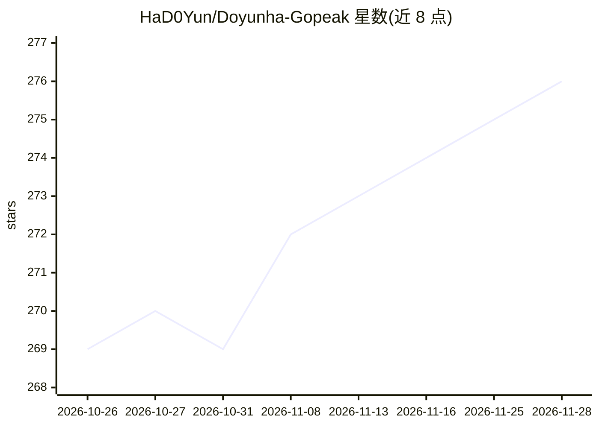

# HaD0Yun/Doyunha-Gopeak

⭐ 276 · TypeScript · MIT · 推送 2026-11-13 · [GitHub](https://github.com/HaD0Yun/Doyunha-Gopeak) · [官网](https://had0yun.github.io/Doyunha-Gopeak/) · 个人维护 · 中文 README

**给 Godot 开发者的 MCP 服务器：让 AI 助手编辑、运行、调试游戏项目**

面向 Godot 4 的 MCP 服务器，为 Claude Desktop、Cursor 等 MCP 客户端提供 95+ 工具：场景与节点管理、GDScript 编辑、LSP 诊断、DAP 断点调试、截图采集、输入注入、ClassDB 内省与 CC0 资产检索。采用 compact 默认工具档位，高级能力通过 setup gate 按需启用（编辑器插件、runtime addon、LSP/DAP 端口）。通过 Bun 全局安装或源码 install.sh 安装，MIT 许可。

## 筛选速览

| 维度 | 判定 | 备注 |
|---|---|---|
| AI 角色 | `ai-ecosystem` | LLM/agent 周边工具 |
| 许可风险 | `permissive` | MIT |
| 部署形态 | `None` |  |
| 模型依赖 | — | README 未给出锁定关系 |
| 硬件要求 | — | 无带数字的原话,不猜 |
| 安装摩擦 | `low` | 无编译、无系统依赖或容器化 |
| 成熟度 | — | 结构信号不足 |

## 能力要点

- 95+ 工具覆盖场景管理、GDScript LSP、DAP 调试、截图、输入注入、ClassDB 内省
- compact/full/legacy 三种工具暴露档位，tool.catalog 动态激活能力组
- 编辑器桥接插件与 runtime addon 分层，端口 6505/6005/6006/7777 各司其职
- tools/list 光标分页，控制大型档位的上下文占用

## 适用场景

- 让 AI 助手直接创建场景、编写 GDScript 并运行项目修错
- 通过 DAP 断点与运行时检查让 AI 参与游戏调试
- 用 AI 搜索并下载 CC0 外部资产

## 场景标签

`编码 Agent` · 领域:编码与开发

## 证据(README 行号)

> L11: **GoPeak is an MCP server for Godot 4 that gives AI assistants a real edit → run → inspect → fix loop.**
> L25: - MCP-compatible client such as Claude Desktop, Cursor, Cline, or OpenCode

## 星数曲线

2026-10-26 269 → 2026-11-28 276（+7）

---
*卡片 v1 · prompt 1.4 · 生成 2026-11-25 · 置信度 high · 依据 README sha `23bdf0de2188` · [字段定义](../../DATASET.md)*
