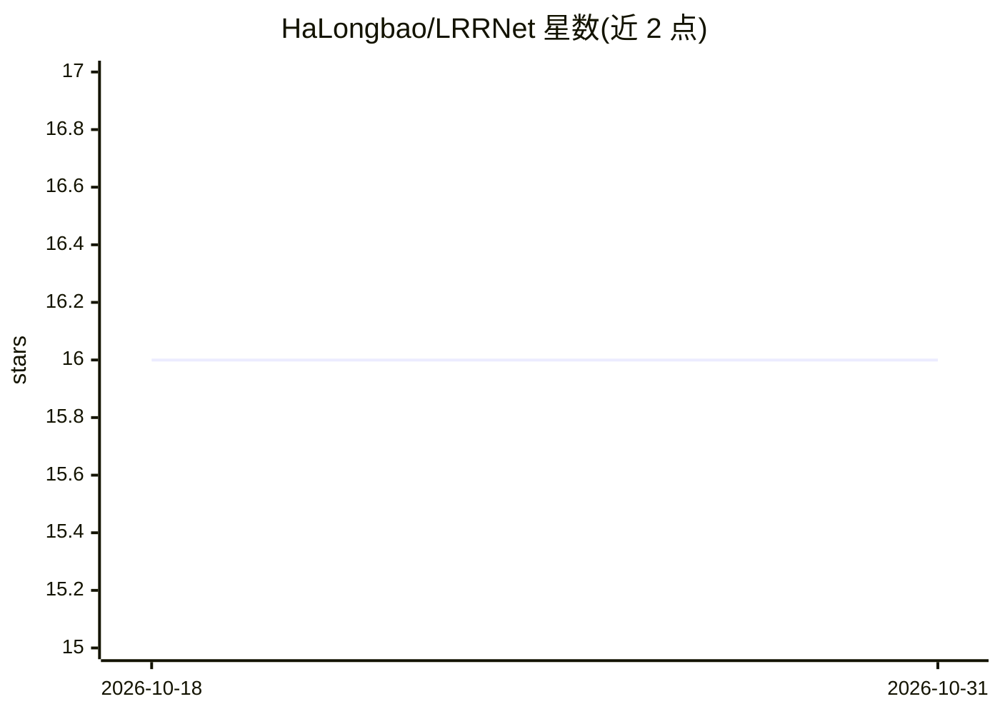

# HaLongbao/LRRNet

⭐ 16 · Python · 推送 2025-12-04 · [GitHub](https://github.com/HaLongbao/LRRNet) · 个人维护

**红外小目标检测网络 LRRNet 官方实现（TGRS'25 论文）**

IEEE TGRS 2025 论文的官方 PyTorch 实现：通过深度网络端到端学习红外图像的低秩背景结构，实现小目标检测，作者称为首个端到端学习低秩背景结构的工作。基于 DPCANet 框架重新实现，在 IRSTD-1K 上复现结果与论文一致（mIoU 72.39）。提供 conda 环境安装、NUDT-SIRST/IRSTD-1K/SIRST-Aug 数据集训练测试流程及 IRDST-1K 预训练权重；作者说明重实现版本可能仍含 bug，且 GPU 训练需 CUDA 11.8。

## 筛选速览

| 维度 | 判定 | 备注 |
|---|---|---|
| AI 角色 | `ai-native` | 本体是模型或模型工具 |
| 许可风险 | `none` | — |
| 部署形态 | `library` | 以包/库形式分发 |
| 模型依赖 | — | README 未给出锁定关系 |
| 硬件要求 | — | 无带数字的原话,不猜 |
| 安装摩擦 | `medium` | 含编译或系统依赖之一 |
| 成熟度 | `idea` | |

## 能力要点

- 深度网络端到端学习低秩背景结构进行红外小目标检测
- 复现结果与论文一致（IRSTD-1K mIoU 72.39）
- 提供训练、推理与 mIoU/F1/Pd/Fa 指标评估脚本
- 附带 IRDST-1K 数据集预训练权重

## 适用场景

- 在公开红外小目标数据集上训练和评估检测模型
- 复现 TGRS 论文实验结果
- 基于低秩表征方法开展红外小目标检测研究

## 场景标签

`目标检测` · 领域:感知与多模态

## 证据(README 行号)

> L17: To the best of our knowledge, this is the **first** work to directly learn low-rank background structures using dee
> L19: Extensive experiments on multiple public datasets demonstrate that LRRNet outperforms 38 state-of-the-art methods i
> L25: #### 2. Since our original implementation was developed for an internal project, we re-implemented a version of LRR

## 星数曲线

2026-10-18 16 → 2026-10-31 16（+0）

---
*卡片 v1 · prompt 1.4 · 生成 2026-10-30 · 置信度 mid · 依据 README sha `ea1af2e40efa` · [字段定义](../../DATASET.md)*
