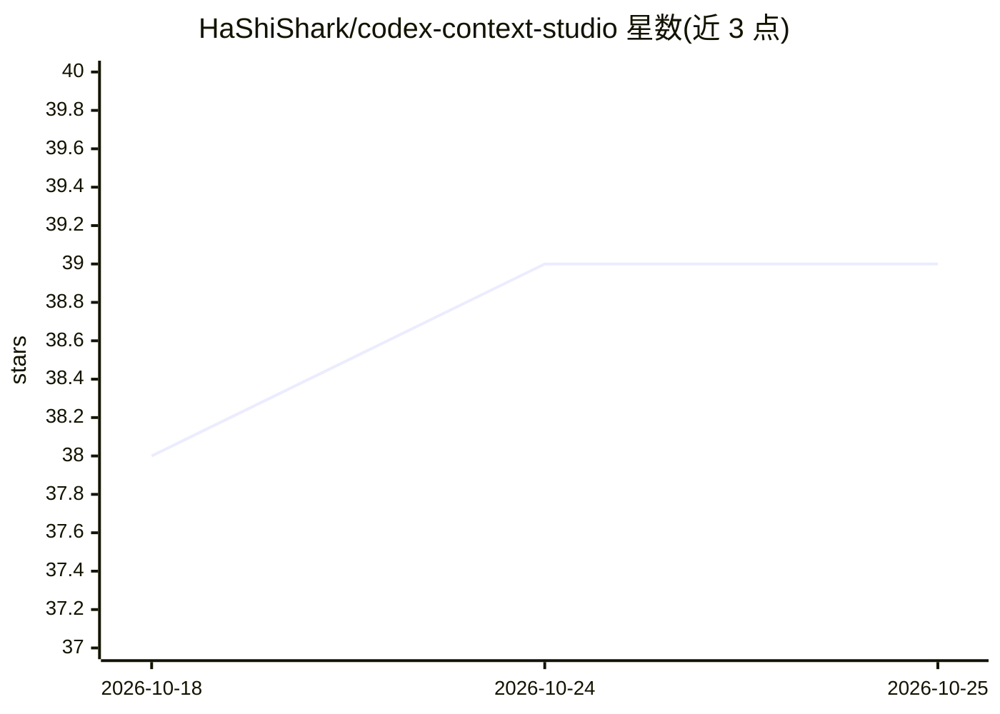

# HaShiShark/codex-context-studio

⭐ 39 · Python · GPL-3.0 · 推送 2026-09-27 · [GitHub](https://github.com/HaShiShark/codex-context-studio) · 个人维护 · 中文 README

**Codex 上下文可视化管理面板：查看、编辑与压缩上下文**

围绕 Codex（OpenAI 的编码 agent）的本地上下文管理层：以本地代理方式拦截 Codex 请求，按角色可视化上下文、逐轮 token 用量与注入时机；支持手动编辑 transcript、接入廉价二级模型做上下文分析与压缩、自动压缩已完成历史并保留关键决策与任务状态；还可替换 Codex 的系统提示词与原生压缩提示词，并提供用量面板（token、缓存命中率、成本估算）。面向希望精细控制 Codex 上下文的高级用户，提供 Windows 安装包，CLI/Desktop 代理通过 codex ctx 命令开关，不修改 Codex 源码。GPL-3.0。

## 筛选速览

| 维度 | 判定 | 备注 |
|---|---|---|
| AI 角色 | `ai-ecosystem` | LLM/agent 周边工具 |
| 许可风险 | `viral` | GPL-3.0 |
| 部署形态 | `None` |  |
| 模型依赖 | — | README 未给出锁定关系 |
| 硬件要求 | — | 无带数字的原话,不猜 |
| 安装摩擦 | `low` | 无编译、无系统依赖或容器化 |
| 成熟度 | — | 结构信号不足 |

## 能力要点

- 本地代理拦截 Codex 请求，按角色可视化上下文与逐轮 token 用量
- 二级模型对话式分析、编辑与压缩主模型上下文
- 自动维护上下文：压缩已完成历史、保留关键决策与任务状态
- 替换系统提示词与原生压缩提示词

## 适用场景

- 查看并手动编辑 Codex 会话中被保留的上下文
- 用自有压缩策略替换 Codex 原生 compaction
- 长会话中自动压缩无关历史并保留任务状态
- 替换 Codex 系统提示词以突破默认限制

## 场景标签

`Agent 记忆` `提示工程` · 领域:Agent 开发

## 证据(README 行号)

> L26: This project lets you see Codex's context consumption, what's retained after compression, and edit it yourself. It 
> L52: > No Codex source code changes, no official tools replaced. Sits in the middle as a local proxy, compatible with al

## 星数曲线

2026-10-18 38 → 2026-10-25 39（+1）

---
*卡片 v1 · prompt 1.4 · 生成 2026-10-25 · 置信度 high · 依据 README sha `056823e4a787` · [字段定义](../../DATASET.md)*
