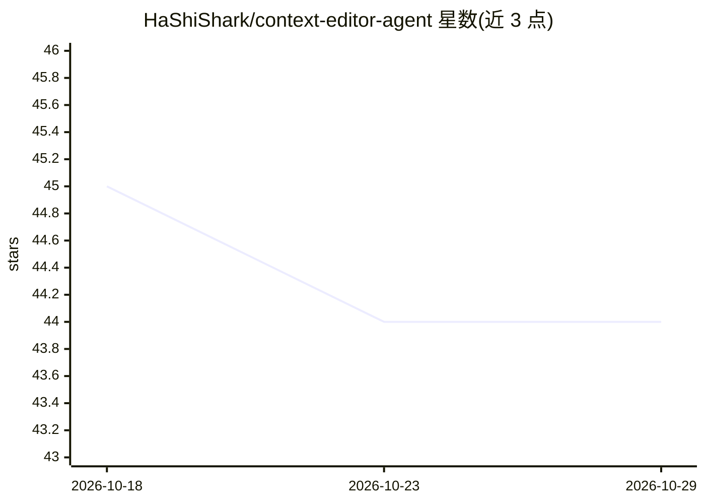

# HaShiShark/context-editor-agent

⭐ 44 · Python · GPL-3.0 · 推送 2026-08-05 · [GitHub](https://github.com/HaShiShark/context-editor-agent) · 个人维护 · 中文 README

**桌面 AI 聊天客户端：可视化并让第二个 AI 精确编辑上下文**

基于 Electron 37 + React 19 + Python 后端的桌面客户端（hashcode）。用户与主模型聊天，同时部署独立的上下文模型，通过 Context Map 将会话转为带 token 权重着色的节点图，可用自然语言指示上下文模型压缩、删除或合并指定节点，修改会提交到正式转录并实际影响主模型后续所见。每轮编辑生成完整快照修订，支持线性回滚与撤销恢复。支持 OpenAI/Claude/Gemini 及 OpenAI 兼容端点，主模型与上下文模型可分别配置。当前为 Alpha，Windows 可构建安装包，macOS/Linux 未支持。

## 筛选速览

| 维度 | 判定 | 备注 |
|---|---|---|
| AI 角色 | `ai-native` | 本体是模型或模型工具 |
| 许可风险 | `viral` | GPL-3.0 |
| 部署形态 | `desktop` | 安装包/桌面程序 |
| 模型依赖 | locked-api |  |
| 硬件要求 | — | 无带数字的原话,不猜 |
| 安装摩擦 | `low` | 无编译、无系统依赖或容器化 |
| 成熟度 | `idea` | |

## 能力要点

- Context Map 将上下文结构化为带 token 权重着色的节点图
- 独立上下文模型执行读取/批量写入/条目编辑三类工具，编辑提交到正式转录
- 每轮编辑生成完整快照修订，支持线性回滚与撤销恢复
- 主模型与上下文模型可分别配置不同提供商（OpenAI/Claude/Gemini/自定义）

## 适用场景

- 长会话中精确压缩或删除过期的工具输出与旧对话轮
- 切换话题时一键清理早前内容并保留可回滚的历史版本
- 诊断上下文膨胀来源，定位占用 token 最多的节点

## 场景标签

`聊天机器人` · 领域:对话与助手

## 证据(README 行号)

> L62: 1. **Visualizes** the entire context your main model actually consumes — as a structured **Context Map**, not a cha
> L63: 2. **Deploys a second AI model** to precisely edit your context — you decide what to keep, what to delete, what to 
> L149: 1. **Main Model** — the AI you chat with. It reads/writes files, runs commands, answers questions.

## 星数曲线

2026-10-18 45 → 2026-10-29 44（-1）

---
*卡片 v1 · prompt 1.4 · 生成 2026-10-25 · 置信度 high · 依据 README sha `7fe05a75e47b` · [字段定义](../../DATASET.md)*
