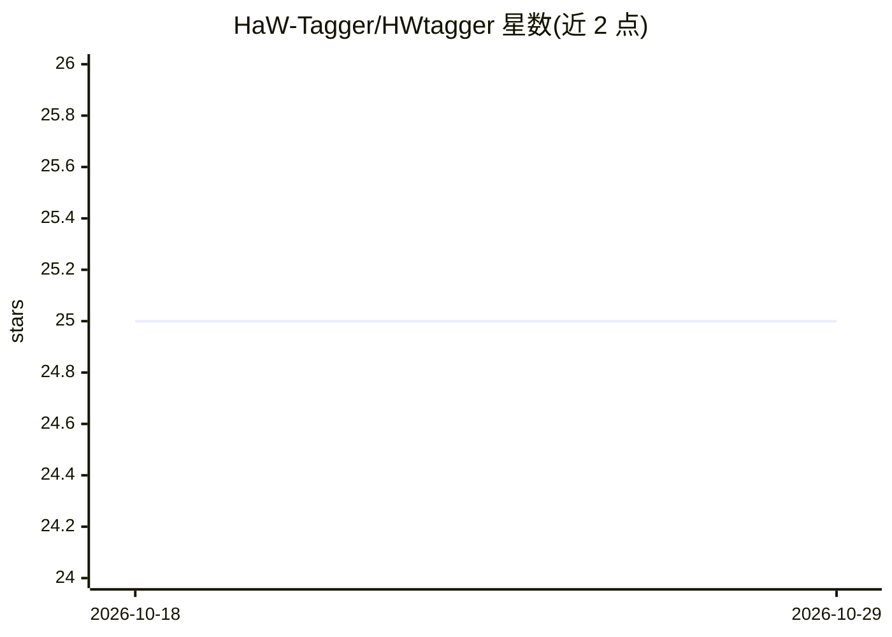

# HaW-Tagger/HWtagger

⭐ 25 · Python · GPL-3.0 · 推送 2025-12-04 · [GitHub](https://github.com/HaW-Tagger/HWtagger) · 组织维护

**面向 Stable Diffusion LoRA 训练的图片自动打标与手动编辑工具**

为训练 Stable Diffusion 的 LoRA/checkpoint 的用户提供的图像标签工具：运行模型自动为图片生成标签，并支持手动编辑标签、标签频率统计与分类过滤、数据库视图与导出合并、生成可配合 LoraEasyTrainer 使用的 TOML 文件，以及图片备份与丢弃管理。模型从 Hugging Face 下载放入 models 文件夹。Windows 为主环境（install.bat/start_app.bat），Linux 有可用反馈但未经维护者验证；GPU 加速需自行安装 CUDA 11.8 与 CUDNN，无 GPU 时应用仍可运行但打标较慢。

## 筛选速览

| 维度 | 判定 | 备注 |
|---|---|---|
| AI 角色 | `ai-native` | 本体是模型或模型工具 |
| 许可风险 | `viral` | GPL-3.0 |
| 部署形态 | `None` |  |
| 模型依赖 | — | README 未给出锁定关系 |
| 硬件要求 | — | 无带数字的原话,不猜 |
| 安装摩擦 | `medium` | 含编译或系统依赖之一 |
| 成熟度 | `idea` | |

## 能力要点

- 运行模型自动为图片生成标签并支持手动编辑
- 标签频率视图、分类过滤与批量清理
- 数据库导出/合并与生成 LoraEasyTrainer 用的 TOML
- 实验性的人脸/手部/人物检测（更新日志声明）

## 适用场景

- 训练 LoRA 前为数据集图片批量打标
- 手动校正自动生成的标签并统计标签频率
- 在用户之间共享打标数据库

## 场景标签

`微调` `目标检测` · 领域:感知与多模态

## 证据(README 行号)

> L1: # Introduction
> L2: This application is tool to help people who train loras for stable diffusion. Its goal is to facilitate automaticall

## 星数曲线

2026-10-18 25 → 2026-10-29 25（+0）

---
*卡片 v1 · prompt 1.4 · 生成 2026-10-27 · 置信度 high · 依据 README sha `0be947dc0fea` · [字段定义](../../DATASET.md)*
