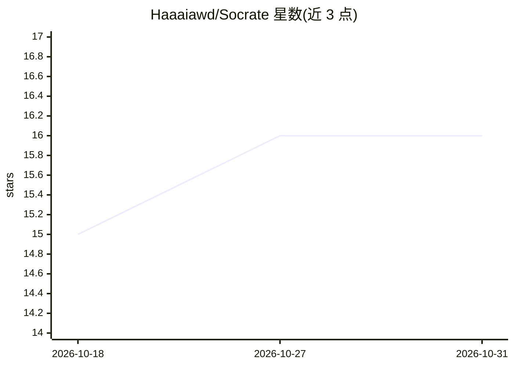

# Haaaiawd/Socrate

⭐ 16 · Python · Apache-2.0 · 推送 2025-11-11 · [GitHub](https://github.com/Haaaiawd/Socrate) · 个人维护 · 中文 README

**苏格拉底式 AI 教学 CLI：通过提问引导学习编程概念**

面向学生的命令行学习工具：CLI 负责初始化学习工作区与分发提示词模板，教学逻辑定义在提示词文件中，依托 GitHub Copilot 与 Claude Code 执行。按 UbD Stage 1（EU/EQ/SWBAT）生成备课文件，提供大纲生成、苏格拉底式对话教学、质量检查三类命令；支持从文件或主题生成学习计划、自动生成练习、TODO 驱动编码与代码审查对话。所有数据以带 YAML frontmatter 的 Markdown 文件存储，无需数据库。

## 筛选速览

| 维度 | 判定 | 备注 |
|---|---|---|
| AI 角色 | `ai-native` | 本体是模型或模型工具 |
| 许可风险 | `permissive` | Apache-2.0 |
| 部署形态 | `library` | 以包/库形式分发 |
| 模型依赖 | locked-api |  |
| 硬件要求 | — | 无带数字的原话,不猜 |
| 安装摩擦 | `low` | 无编译、无系统依赖或容器化 |
| 成熟度 | — | 结构信号不足 |

## 能力要点

- 教学逻辑全部定义在提示词模板中，CLI 仅做初始化与分发
- 支持 GitHub Copilot 与 Claude Code 两套语义镜像的提示词
- 按 UbD Stage 1（EU/EQ/SWBAT）生成备课与三层问题设计
- 数据存储为 Markdown + YAML frontmatter，无需数据库

## 适用场景

- 通过苏格拉底式提问学习 Python 等编程概念
- 上传教材 PDF/Markdown 自动生成结构化学习计划并跟踪进度
- 在 VS Code Copilot Chat 或 Claude Code 中进行对话式学习

## 场景标签

 · 领域:教育/编程学习

## 证据(README 行号)

> L5: Socrate 是一个基于苏格拉底式对话法的 AI 教学助手 CLI 工具。通过提问引导学习，而非直接给出答案，帮助学生深入理解编程概念。
> L116: Socrate **不是传统的 CLI 工具**。它是一组 **AI 提示词模板** 的集合，通过对话来教学：

## 星数曲线

2026-10-18 15 → 2026-10-31 16（+1）

---
*卡片 v1 · prompt 1.4 · 生成 2026-10-30 · 置信度 high · 依据 README sha `ec8a67792cb0` · [字段定义](../../DATASET.md)*
