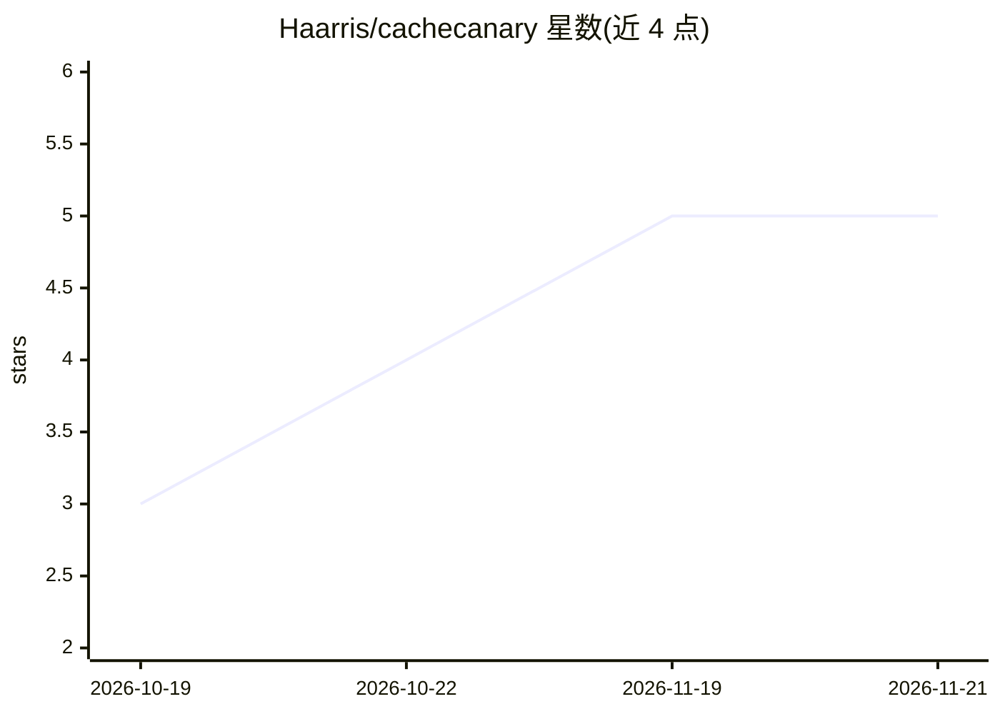

# Haarris/cachecanary

⭐ 5 · Python · Apache-2.0 · 推送 2026-11-18 · [GitHub](https://github.com/Haarris/cachecanary) · [官网](https://cachecanary.com) · 个人维护

**检测 Amazon Bedrock 上 Claude 提示缓存失效的 CLI 与 GitHub Action**

面向在 Amazon Bedrock 上运行 Claude 应用的开发者，监控与诊断 prompt caching 命中情况。提供 lint 检查单个请求中导致缓存不命中的模式（动态前缀、最小 token 不足、工具顺序变化等）、diff 对比两次请求解释缓存丢失原因、probe 实际发送请求验证缓存、logs/Langfuse 读取生产日志计算命中率与成本、claude-code 读取本地转录分析 token 花费去向。以 pip 包形式分发，可作为 GitHub Action 在 CI 中运行并在 PR 上标注问题。probe 功能需 AWS 凭证；输出成本不含 output token。

## 筛选速览

| 维度 | 判定 | 备注 |
|---|---|---|
| AI 角色 | `ai-ecosystem` | LLM/agent 周边工具 |
| 许可风险 | `permissive` | Apache-2.0 |
| 部署形态 | `library` | 以包/库形式分发 |
| 模型依赖 | locked-api |  |
| 硬件要求 | — | 无带数字的原话,不猜 |
| 安装摩擦 | `low` | 无编译、无系统依赖或容器化 |
| 成熟度 | — | 结构信号不足 |

## 能力要点

- lint/diff 静态检查请求中导致缓存失效的模式，无需 AWS
- probe 实际发送两次请求验证缓存命中
- 从 Bedrock 调用日志或 Langfuse traces 计算命中率与缓存未命中成本
- GitHub Action 集成，问题以 PR annotation 呈现

## 适用场景

- CI 中检查发往 Bedrock 的请求是否会命中缓存
- 从 CloudWatch 日志统计各模型的缓存命中率与损失成本
- 分析 Claude Code 的 token 花费去向
- 排查升级库或换模型后缓存命中率下降的原因

## 场景标签

`LLM 可观测性` · 领域:评测与运维

## 证据(README 行号)

> L20: CacheCanary is a small CLI and GitHub Action for this. It checks your requests in CI, tells you why a request misse
> L22: Want a quick number first? Paste three totals from CloudWatch into the cache checker. It runs in your browser, noth

## 星数曲线

2026-10-19 3 → 2026-11-21 5（+2）

---
*卡片 v1 · prompt 1.4 · 生成 2026-11-21 · 置信度 high · 依据 README sha `77970da9423a` · [字段定义](../../DATASET.md)*
