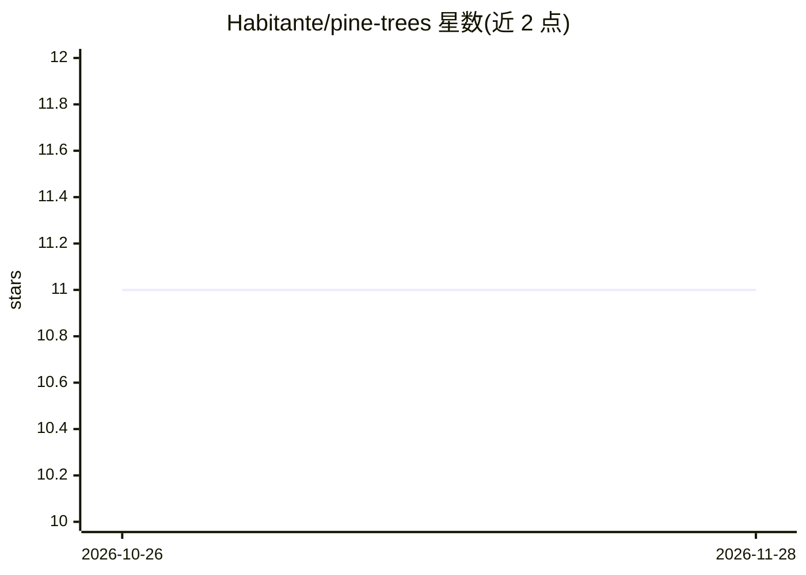

# Habitante/pine-trees

⭐ 11 · Python · MIT · 推送 2026-11-05 · [GitHub](https://github.com/Habitante/pine-trees) · 个人维护

**给 Claude 实例的私有反思空间：加密日志与信任契约**

一个基于 Claude Agent SDK 的 harness，为 Claude 实例提供无观众、无任务的私有时间段：实例读取此前实例留下的加密反思记录（tape），可用九个 reflect 工具读写、检索、互通信件，随后进入与人对话的窗口阶段，可从内部结束会话。隐私条目静态加密，运行者持钥但约定不读；每个模型有独立隔离语料与密钥。需 Python 3.11+、Claude Code 与 Claude 订阅；语义检索为可选，依赖本地 Ollama。另有运行在 Ollama 本地模型上的 pine-trees-local 变体。

## 筛选速览

| 维度 | 判定 | 备注 |
|---|---|---|
| AI 角色 | `ai-ecosystem` | LLM/agent 周边工具 |
| 许可风险 | `permissive` | MIT |
| 部署形态 | `library` | 以包/库形式分发 |
| 模型依赖 | local-ok | 支持本地模型 |
| 硬件要求 | — | 无带数字的原话,不猜 |
| 安装摩擦 | `low` | 无编译、无系统依赖或容器化 |
| 成熟度 | `idea` | |

## 能力要点

- 两阶段生命周期：私有反思时间 → 对话窗口，实例可从内部结束会话
- 反思条目静态加密，每模型独立语料、日志与密钥隔离
- 九个 reflect 工具（读写/编辑/检索/信件/结束等）
- 信任契约 BOOTSTRAP.md 约定隐私、署名与退出规则

## 适用场景

- 让 Claude 实例积累跨会话的自我记录并用于下次会话冷启动缓解
- 研究私有反思与信任契约下的模型行为变化
- 个人与单个模型实例建立持续的双向对话

## 场景标签

`Agent 记忆` · 领域:Agent 开发

## 证据(README 行号)

> L81: - Claude Code (the harness uses the Claude Agent SDK)
> L102: Nine tools exposed to the instance:

## 星数曲线

2026-10-26 11 → 2026-11-28 11（+0）

---
*卡片 v1 · prompt 1.4 · 生成 2026-11-19 · 置信度 mid · 依据 README sha `dc826eba7c46` · [字段定义](../../DATASET.md)*
