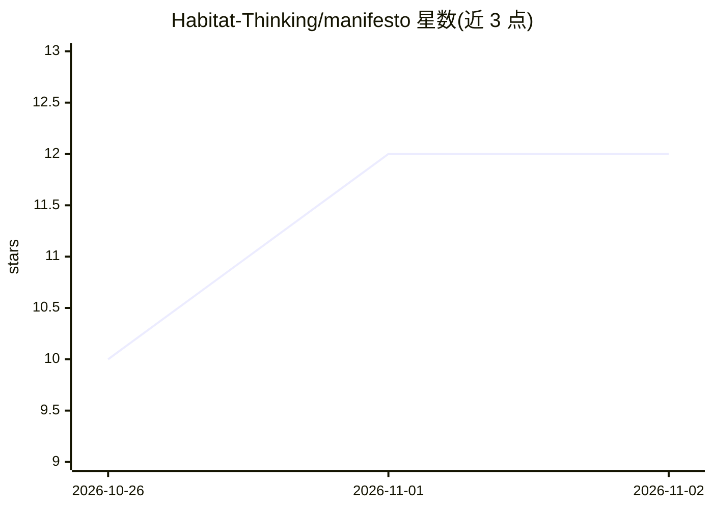

# Habitat-Thinking/manifesto

⭐ 12 · CC-BY-SA-4.0 · 推送 2026-09-11 · [GitHub](https://github.com/Habitat-Thinking/manifesto) · 个人维护

**关于人与 AI 协作者共处工作环境的宣言文档**

一份名为 Habitat Thinking Manifesto 的宣言文本，作者 Russ Miles，定位为 AI 协作者时代下 Agile Manifesto 的伴随文档。内容为价值观陈述（如“房间内的整体认知高于屏幕上的代码”“持续的人类理解高于产出吞吐”）与原则条目，主张把人、agent、代码、约定与反馈回路构成的整体视为一个“栖息地”，并讨论问责归属、理解作为交付物等议题。文档以 CC BY-SA 4.0 许可发布，版本 1.1.0，无代码、无安装运行方式，提到配套的 AI Readiness Assessment 实践文档。

## 筛选速览

| 维度 | 判定 | 备注 |
|---|---|---|
| AI 角色 | `ai-knowledge` | 知识聚合/清单类 |
| 许可风险 | `viral` | CC-BY-SA-4.0 |
| 部署形态 | `None` |  |
| 模型依赖 | — | README 未给出锁定关系 |
| 硬件要求 | — | 无带数字的原话,不猜 |
| 安装摩擦 | `low` | 无编译、无系统依赖或容器化 |
| 成熟度 | — | 结构信号不足 |

## 能力要点

- 以 7 组价值观对照和 8 条原则陈述人-AI 协作工作环境的设计取向
- 将人、agent、代码与反馈回路整体视为可评估的“栖息地”
- 以 CC BY-SA 4.0 许可，允许商用改编（相同许可传染）
- 文档标注版本号并声明预期会变更

## 适用场景

- 团队在引入 AI 协作者时作为讨论价值观与原则的共同文本
- 与 Agile Manifesto 对照阅读，形成对 AI 时代工作方式的讨论起点
- 引用特定版本来支持或对照自己的团队实践主张

## 场景标签

 · 领域:软件工程/人机协作理念

## 证据(README 行号)

> L1: # The Habitat Thinking Manifesto
> L45: Habitat Thinking is a lens. It puts the room — the people, the agents, the code, the conventions, the feedback loop

## 星数曲线

2026-10-26 10 → 2026-11-02 12（+2）

---
*卡片 v1 · prompt 1.4 · 生成 2026-11-01 · 置信度 mid · 依据 README sha `82f7d534744b` · [字段定义](../../DATASET.md)*
