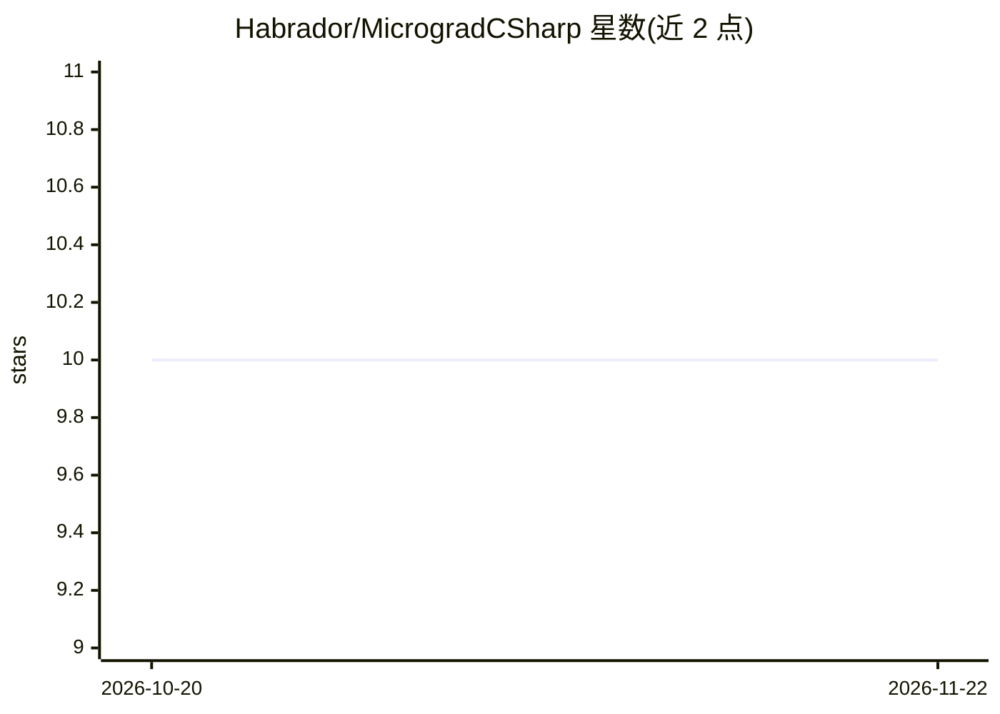

# Habrador/MicrogradCSharp

⭐ 10 · C# · MIT · 推送 2026-04-28 · [GitHub](https://github.com/Habrador/MicrogradCSharp) · 个人维护

**Unity/C# 环境的标量自动微分引擎与神经网络库**

以 C# 实现的标量值自动微分（autograd）引擎与神经网络库，面向在 Unity 游戏引擎内构建和训练神经网络的开发者；库本身不含 Unity 专属代码，也可用于其他 C# 项目。提供 Tanh/Relu/Sigmoid/Softmax 激活函数、NLL/MSE 损失、SGD with momentum/Adam 优化器、批次管理工具，并附回归、分类（如 XOR 门）示例代码；Value 类通过 .Backward() 求导。项目灵感来自 Andrej Karpathy 的 micrograd。README 未给出安装命令与硬件要求。

## 筛选速览

| 维度 | 判定 | 备注 |
|---|---|---|
| AI 角色 | `ai-native` | 本体是模型或模型工具 |
| 许可风险 | `permissive` | MIT |
| 部署形态 | `None` |  |
| 模型依赖 | — | README 未给出锁定关系 |
| 硬件要求 | — | 无带数字的原话,不猜 |
| 安装摩擦 | `low` | 无编译、无系统依赖或容器化 |
| 成熟度 | — | 结构信号不足 |

## 能力要点

- 标量值自动微分引擎，Value 类调用 .Backward() 即可求导
- 内置 4 种激活函数、2 种损失函数与 SGD/Adam 优化器
- 逐层或一次性添加网络层的 MLP 构建 API
- 附 XOR 门等回归与分类训练示例

## 适用场景

- 在 Unity 中为游戏 AI 原型训练小型神经网络
- 在 C# 项目中做回归或分类任务
- 学习反向传播与自动微分的工作原理

## 场景标签

 · 领域:机器学习库/游戏开发

## 证据(README 行号)

> L3: MicrogradCSharp is an open-source Artificial Intelligence project. It implements a scalar-valued automatic different
> L5: This library provides a lightweight, efficient, and simple way to build and train Neural Networks directly in Unity.

## 星数曲线

2026-10-20 10 → 2026-11-22 10（+0）

---
*卡片 v1 · prompt 1.4 · 生成 2026-11-20 · 置信度 high · 依据 README sha `a33f195c19bd` · [字段定义](../../DATASET.md)*
