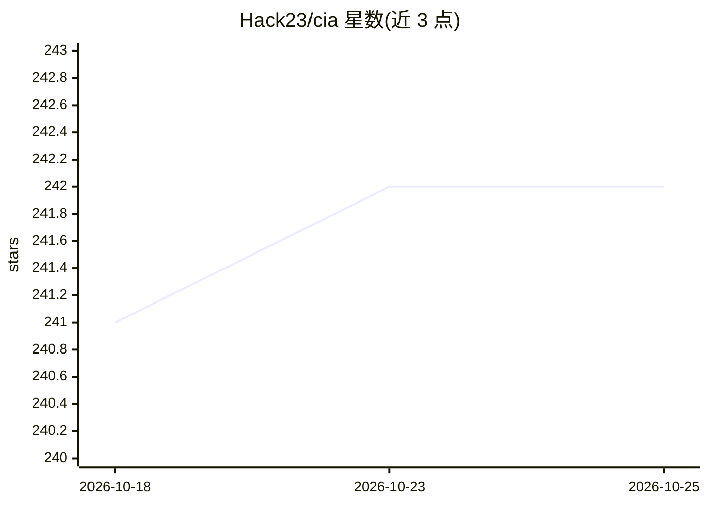

# Hack23/cia

⭐ — · [GitHub]() · 组织维护

**瑞典政治OSINT分析平台：追踪议会、政府与公共机构数据**

面向公民、记者、研究者与政策制定者的开源情报（OSINT）平台，监控瑞典议会、政府与公共机构，数据回溯至1971年。基于官方开放数据（Riksdagen、Valmyndigheten、World Bank、ESV）生成财务绩效指标、50条行为风险检测规则（Drools规则引擎）、110个数据库视图与6类分析框架（时序、对比、模式识别、预测、网络、决策情报）。技术栈为 Java 26 / Spring / Vaadin / PostgreSQL 18，共49个Maven模块，Apache 2.0 许可，声称不收集终端用户PII。

## 筛选速览

| 维度 | 判定 | 备注 |
|---|---|---|
| AI 角色 | `ai-enhanced` | 去掉 AI 部分产品仍成立 |
| 许可风险 | `permissive` | — |
| 部署形态 | `None` |  |
| 模型依赖 | — | README 未给出锁定关系 |
| 硬件要求 | — | 无带数字的原话,不猜 |
| 安装摩擦 | `medium` | 含编译或系统依赖之一 |
| 成熟度 | — | 结构信号不足 |

## 能力要点

- 50条行为风险检测规则（政客/政党/委员会/部委/决策6类）
- 110个数据库视图与6个分析框架
- 4个官方OSINT数据源，数据回溯至1971年
- 49个Maven模块、1300+ Java文件，含完整C4架构与威胁模型文档

## 适用场景

- 查看瑞典政客与政党的绩效记分板与排名
- 分析议会投票、动议与决策的趋势与风险
- 追踪政府部委与公共机构的财政与问责指标

## 场景标签

`数据分析` · 领域:效率与自动化

## 证据(README 行号)

> L66: - 📈 **Political trend analysis** — temporal, comparative, pattern-recognition, predictive, network and decision int
> L192: |⚙️ Drools Risk Rules|Engine|Drools rules engine documentation|
> L108: |⚠️ **Risk Rules**|**50**|24 politician · 10 party · 4 committee · 4 ministry · 5 decision · 3 other|

## 星数曲线

2026-10-18 241 → 2026-10-25 242（+1）

---
*卡片 v1 · prompt 1.4 · 生成 2026-10-22 · 置信度 mid · 依据 README sha `769cfb14c2bb` · [字段定义](../../DATASET.md)*
