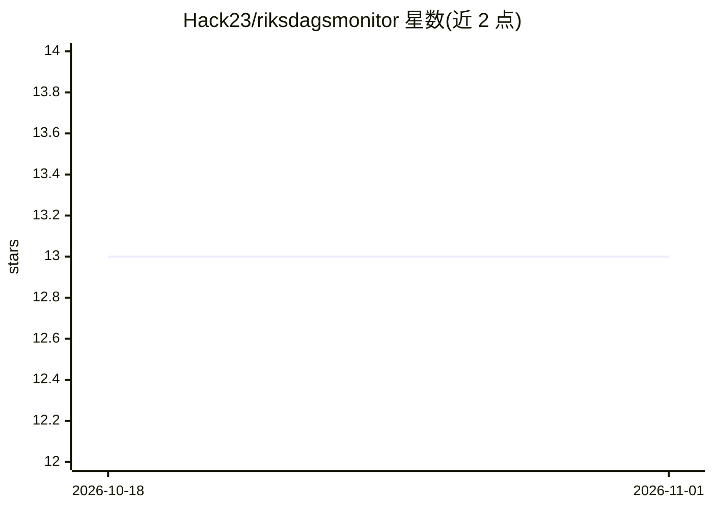

# Hack23/riksdagsmonitor

⭐ 13 · HTML · Apache-2.0 · 推送 2026-10-31 · [GitHub](https://github.com/Hack23/riksdagsmonitor) · [官网](https://riksdagsmonitor.com) · 组织维护

**瑞典议会政治情报平台：AI 新闻室自动生成多语言分析**

监测瑞典议会、政府与公共机构的政治情报平台：以 ACH、SWOT、PESTLE、STRIDE 等结构化情报方法分析 349 名现任议员、1971–2024 历史政治人物、350 万+投票与 10.9 万+议会文件。核心机制为 14 个自主 agentic 工作流（使用 Claude Opus 4.8，翻译用 Claude Sonnet 4.6，经 GitHub Copilot Coding Agent 调度），零人工编辑地每日生成 14 种语言的情报文章；每条声明须溯源至官方数据，设有分析产物硬性门槛与 CI 质量门（WCAG 2.1 AA、翻译校验）。面向公民、记者、研究者与政策制定者，开源 Apache-2.0，以网站形式交付，npm 包提供。

## 筛选速览

| 维度 | 判定 | 备注 |
|---|---|---|
| AI 角色 | `ai-native` | 本体是模型或模型工具 |
| 许可风险 | `permissive` | Apache-2.0 |
| 部署形态 | `library` | 以包/库形式分发 |
| 模型依赖 | locked-api |  |
| 硬件要求 | — | 无带数字的原话,不猜 |
| 安装摩擦 | `low` | 无编译、无系统依赖或容器化 |
| 成熟度 | — | 结构信号不足 |

## 能力要点

- 14 个每日自主运行的 agentic 新闻工作流，零人工编辑
- 覆盖 50+ 年议会数据（350 万+投票、10.9 万+文件）
- 每篇 14 语言文章带 JSON-LD 溯源与 dok_id 级审计链
- 分析产物硬性门槛：文章生成前须产出 9/14 个分析工件

## 适用场景

- 跟踪瑞典议会议案、投票与委员会动态的每日情报
- 以 OSINT 方法获取可溯源的多党派平衡政治分析
- 以 14 种语言获取瑞典政治的自动化分析文章

## 场景标签

 · 领域:政治情报/新闻自动化

## 证据(README 行号)

> L17:  An autonomous AI newsroom — 14 agentic workflows, Claude Opus 4.8 (Claude Sonnet 4.6 for translation), zero human 
> L61: - 🤖 **AI-generated political news** — a fully autonomous newsroom turning open data into 14-language analysis artic

## 星数曲线

2026-10-18 13 → 2026-11-01 13（+0）

---
*卡片 v1 · prompt 1.4 · 生成 2026-11-01 · 置信度 high · 依据 README sha `526aab1fb140` · [字段定义](../../DATASET.md)*
