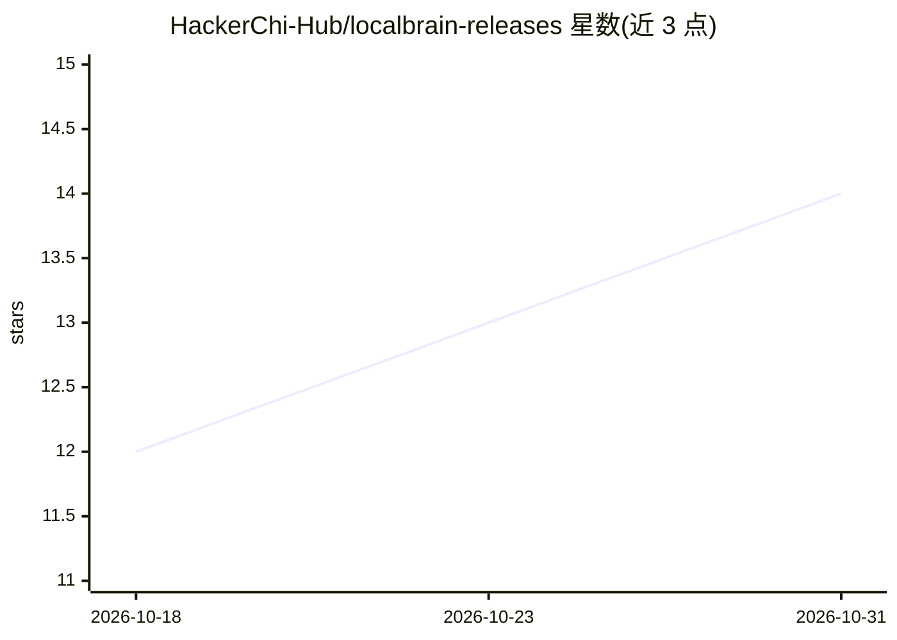

# HackerChi-Hub/localbrain-releases

⭐ 14 · JavaScript · 推送 2026-10-30 · [GitHub](https://github.com/HackerChi-Hub/localbrain-releases) · [官网](https://hyphentech.top/localbrain) · 组织维护 · 中文 README

**本地大模型与文件、语音/图片/视频任务的桌面工作台**

黑粉科技开发的本地 AI 桌面工作台，面向希望在自有电脑上运行大语言模型并管理文件、语音、图片、视频、音乐任务的用户。整合模型下载/导入/启停、流式对话、附件、工具调用与任务恢复；Mac 提供 MLX、Metal llama.cpp 集成，Windows 用适配 llama.cpp，Linux 为预览支持。另含显式授权下的本地安全检查能力与 MCP 工具接入。安装包本地签名、Mac 未 Apple 公证，Linux 仅限 WSL2/Xvfb 验收，大量功能标注了未完成验收的边界。

## 筛选速览

| 维度 | 判定 | 备注 |
|---|---|---|
| AI 角色 | `ai-native` | 本体是模型或模型工具 |
| 许可风险 | `none` | — |
| 部署形态 | `None` |  |
| 模型依赖 | — | README 未给出锁定关系 |
| 硬件要求 | — | 无带数字的原话,不猜 |
| 安装摩擦 | `medium` | 含编译或系统依赖之一 |
| 成熟度 | `idea` | |

## 能力要点

- 本地模型下载、导入、启停与流式对话、附件、工具调用
- 语音、图片、视频、音乐工作台（依模型能力）
- Mac 集成 MLX、Metal llama.cpp，Windows/Linux 使用适配 llama.cpp
- 显式逐目标授权的本地安全检查（端口/时限受限，无漏洞利用框架）

## 适用场景

- 在本机离线运行大语言模型进行对话与文件处理
- 管理本地模型并通过 MCP 给 Codex/Claude Code 等客户端接入工具
- 在授权范围内对自己的主机做基础安全检查

## 场景标签

`AI 助手` `网络安全` · 领域:对话与助手

## 证据(README 行号)

> L5: **把本地大模型、文件工具和媒体生成放进一个桌面应用，按自己的授权范围完成任务。**
> L7: 方寸智匣是黑粉科技开发的本地 AI 工作台，面向希望在电脑上运行大语言模型、处理文件和管理语音、图片、视频、音乐任务的用户。它整合模型下载、导入、启停、流式对话、附件和工具调用；模型规划任务，程序保留真实执行回执。Apple Sil
> L257: 本地模型下载、导入、启停；流式对话、附件、思考控制、硬件感知上下文预算与任务恢复；已授权文件、项目构建测试、文档和网页工具；已集成模型的语音、图片、视频、音乐工作台；MCP、本地模型接口、存储管理和三语界面。媒体详细参数依模型能
> L268: Mac支持已集成MLX、Metal llama.cpp、Splash与Prism；Windows使用适配llama.cpp/Prism，不支持MLX/Splash。Linux近期新增预览，受管llama.cpp/Prism下载未

## 星数曲线

2026-10-18 12 → 2026-10-31 14（+2）

---
*卡片 v1 · prompt 1.4 · 生成 2026-10-31 · 置信度 high · 依据 README sha `96e0aa2cb20a` · [字段定义](../../DATASET.md)*
