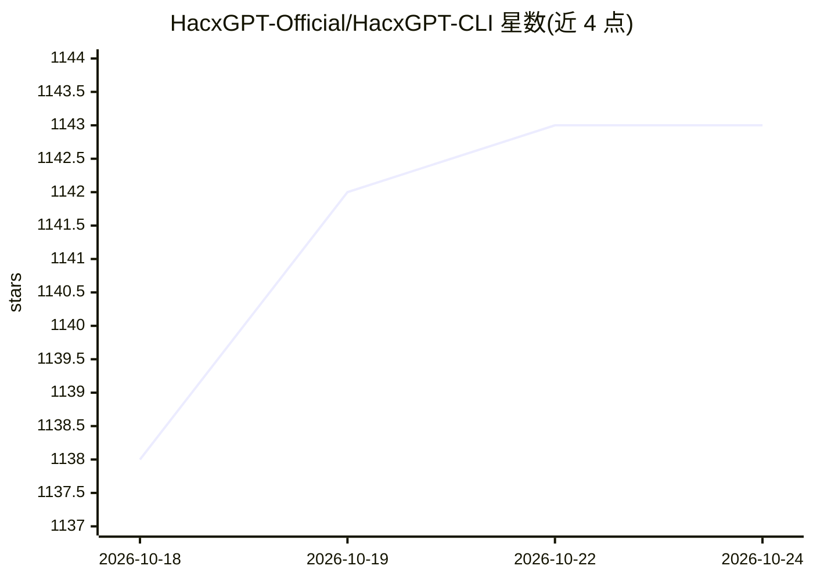

# HacxGPT-Official/HacxGPT-CLI

⭐ 1,143 · Python · NOASSERTION · 推送 2026-06-16 · [GitHub](https://github.com/HacxGPT-Official/HacxGPT-CLI) · [官网](https://hacxgpt.com) · 组织维护

**命令行 AI 聊天客户端，自带密钥接入多平台模型**

开源 Python 命令行工具，作为接口层连接 OpenRouter、Groq 与 HacxGPT API 等提供商，需用户自带 API key（BYOK）。V2.1.1 起用自研 api.py 引擎替代 openai/litellm SDK，请求直连所选提供商；支持多提供商/模型切换、会话保存加载（/save /load）、CoT 推理渲染与内置自动更新。README 说明其含旨在降低模型审查的系统提示词（jailbreak prompts），API key 以机器绑定方式加密存于本地 ~/.hacx。另有付费 HacxGPT Production API（自训模型）供订阅，属同维护方的另一产品。

## 筛选速览

| 维度 | 判定 | 备注 |
|---|---|---|
| AI 角色 | `ai-ecosystem` | LLM/agent 周边工具 |
| 许可风险 | `none` | NOASSERTION |
| 部署形态 | `library` | 以包/库形式分发 |
| 模型依赖 | locked-api |  |
| 硬件要求 | — | 无带数字的原话,不猜 |
| 安装摩擦 | `low` | 无编译、无系统依赖或容器化 |
| 成熟度 | — | 结构信号不足 |

## 能力要点

- 自研本地 API 引擎，不依赖 openai/litellm 第三方 SDK
- 支持 OpenRouter / Groq / HacxGPT API 多提供商切换
- 会话持久化（/save /load /sessions）与 <think> 推理渲染
- API key 机器绑定加密，存储于本地 ~/.hacx

## 适用场景

- 在终端里用自带 API key 与多平台模型对话
- 在 Linux/Windows/macOS/Termux 上切换不同提供商与模型
- 保存并恢复历史会话继续对话

## 场景标签

`聊天机器人` · 领域:对话与助手

## 证据(README 行号)

> L48: This repository is an **open-source command-line interface** that makes powerful AI models accessible without heavy
> L61: - This is a **wrapper/interface framework** that connects to AI providers

## 星数曲线

2026-10-18 1,138 → 2026-10-24 1,143（+5）

---
*卡片 v1 · prompt 1.4 · 生成 2026-10-21 · 置信度 high · 依据 README sha `618576742509` · [字段定义](../../DATASET.md)*
