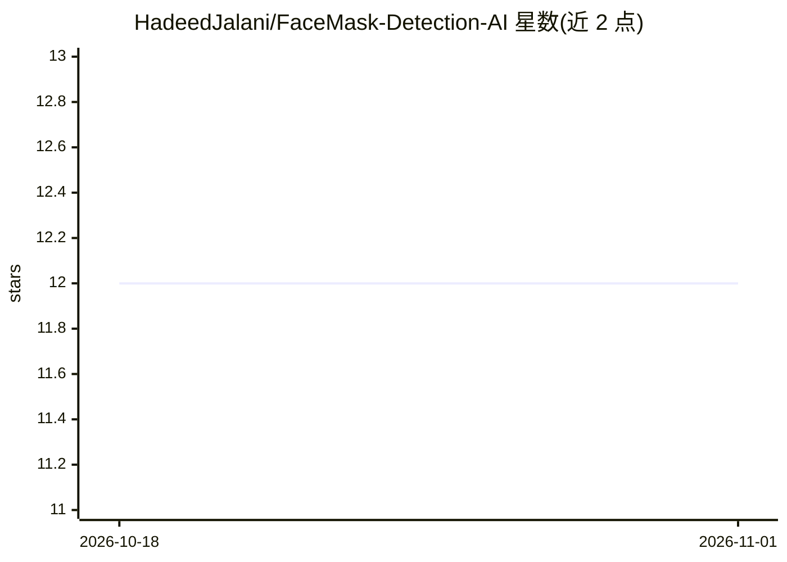

# HadeedJalani/FaceMask-Detection-AI

⭐ 12 · Python · 推送 2026-09-03 · [GitHub](https://github.com/HadeedJalani/FaceMask-Detection-AI) · 个人维护

**检测图像/视频/摄像头中人脸口罩佩戴的 YOLO 应用**

基于 Ultralytics YOLO 的计算机视觉项目：从图片、视频文件与摄像头实时流中检测是否佩戴口罩，视频与摄像头模式下用 ByteTrack 跨帧保持同一人的 Track ID，维护实时检测统计。可配置置信度阈值、图像尺寸、模型权重与 CPU/GPU 设备；附带 Colab 训练笔记本、输出 Precision/Recall/mAP 的评测脚本、unittest 测试套件与 GitHub Actions CI。通过 git clone 加 requirements.txt 安装，模型权重需另行脚本下载。

## 筛选速览

| 维度 | 判定 | 备注 |
|---|---|---|
| AI 角色 | `ai-native` | 本体是模型或模型工具 |
| 许可风险 | `none` | — |
| 部署形态 | `library` | 以包/库形式分发 |
| 模型依赖 | — | README 未给出锁定关系 |
| 硬件要求 | — | 无带数字的原话,不猜 |
| 安装摩擦 | `medium` | 含编译或系统依赖之一 |
| 成熟度 | — | 结构信号不足 |

## 能力要点

- 图像/视频/摄像头三种输入源的口罩检测
- ByteTrack 多目标跟踪，跨帧维持同一人 Track ID
- 评测脚本输出 Precision/Recall/mAP@50/mAP@50-95
- 附带 Colab 训练笔记本与自动化测试

## 适用场景

- 对监控视频或摄像头画面统计口罩佩戴情况
- 在自己的口罩数据集上训练并评测 YOLO 模型
- 作为 YOLO 检测+跟踪应用的结构参考进行二次开发

## 场景标签

`目标检测` · 领域:感知与多模态

## 证据(README 行号)

> L20: **FaceMask Detection AI** is a computer vision project designed to detect whether people are wearing face masks usi
> L41: Uses a YOLO object detection model to identify face-mask-related classes in visual input.

## 星数曲线

2026-10-18 12 → 2026-11-01 12（+0）

---
*卡片 v1 · prompt 1.4 · 生成 2026-11-01 · 置信度 high · 依据 README sha `d7f42564232e` · [字段定义](../../DATASET.md)*
