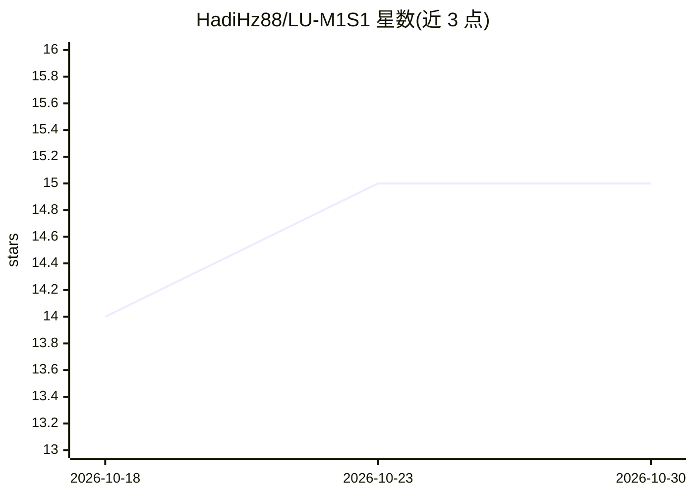

# HadiHz88/LU-M1S1

⭐ 15 · HTML · 推送 2026-02-11 · [GitHub](https://github.com/HadiHz88/LU-M1S1) · 个人维护

**黎巴嫩大学计算机硕士一年级课程资料与笔记合集**

学生维护的课程学习资料仓库：收录黎巴嫩大学 Hadath 校区计算机硕士一年级第一学期（2025/2026）7 门课程（应用数学与统计、云计算、机器学习、网络 III、MERN 高级 Web 开发、多媒体处理）的实验、讲义导出、代码、notebook、Markdown 摘要、概念速查、外部资源与备考材料。内容按课程代码组织，通过 Git 拉取更新，接受 Issue 与协作贡献。声明为学生维护、不保证覆盖全部课程内容。

## 筛选速览

| 维度 | 判定 | 备注 |
|---|---|---|
| AI 角色 | `ai-knowledge` | 知识聚合/清单类 |
| 许可风险 | `none` | — |
| 部署形态 | `None` |  |
| 模型依赖 | — | README 未给出锁定关系 |
| 硬件要求 | — | 无带数字的原话,不猜 |
| 安装摩擦 | `low` | 无编译、无系统依赖或容器化 |
| 成熟度 | — | 结构信号不足 |

## 能力要点

- 7 门硕士课程（IN400–IN433）的实验、讲义与代码材料
- Markdown 课程摘要与关键概念速查
- 策展外部资源链接与备考学习指南
- 按课程代码组织，支持 Git 拉取与社区协作

## 适用场景

- 黎巴嫩大学 CS 硕士 M1S1 学生按课程查找讲义与摘要
- 课后复习关键概念与备考
- 同学协作纠错并补充学习资源

## 场景标签

`教程课程` · 领域:学习与行业

## 证据(README 行号)

> L3: Hi, this is Hadi. This repository is a comprehensive collection of **course materials**, summaries, notes, and exter
> L9: - **Organized course materials** (labs, slides/exports, code, notebooks)

## 星数曲线

2026-10-18 14 → 2026-10-30 15（+1）

---
*卡片 v1 · prompt 1.4 · 生成 2026-10-30 · 置信度 high · 依据 README sha `ca5b7e98d7f0` · [字段定义](../../DATASET.md)*
