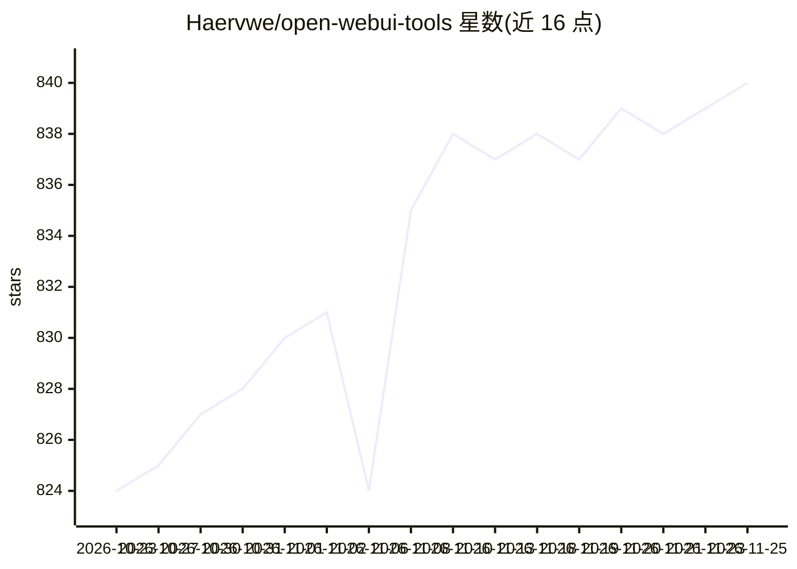

# Haervwe/open-webui-tools

⭐ 840 · Python · MIT · 推送 2026-11-11 · [GitHub](https://github.com/Haervwe/open-webui-tools) · 个人维护

**为 Open WebUI 扩展 20+ 工具、管道与过滤器的插件集合**

面向 Open WebUI 实例的模块化扩展工具集，包含 20 余个工具（arXiv 检索、网络搜索、Pexels/YouTube 媒体搜索、ComfyUI 图像/音乐/视频生成、3D 模型查看等）、功能管道（自主规划 Agent、MCTS 研究、多模型对话、Letta Agent 等）与过滤器（语义路由、提示增强等）。安装通过 Open WebUI Hub 或手动粘贴 .py 文件到 Workspace 完成；部分工具需要 ComfyUI、Mopidy 或相应 API key 等可选依赖，运行前提为 Open WebUI 0.6.0+ 与 Python 3.8+。

## 筛选速览

| 维度 | 判定 | 备注 |
|---|---|---|
| AI 角色 | `ai-ecosystem` | LLM/agent 周边工具 |
| 许可风险 | `permissive` | MIT |
| 部署形态 | `library` | 以包/库形式分发 |
| 模型依赖 | local-ok | 支持本地模型 |
| 硬件要求 | — | 无带数字的原话,不猜 |
| 安装摩擦 | `low` | 无编译、无系统依赖或容器化 |
| 成熟度 | — | 结构信号不足 |

## 能力要点

- 20+ 工具/管道/过滤器，覆盖学术检索、多模态生成与自主 Agent
- arXiv 搜索与 MCTS 研究管道无需额外检索 API key
- 通过 Open WebUI Hub 或手动粘贴代码安装
- 支持 ComfyUI 工作流与 Ollama 模型管理集成

## 适用场景

- 在 Open WebUI 聊天内检索 arXiv 论文做学术调研
- 接入 ComfyUI 在对话中生成图像、音乐与短视频
- 配置自主规划 Agent 与多模型讨论管道
- 为 OpenRouter 模型启用带引用的网络搜索

## 场景标签

`图像生成` `视频生成` `科研工具` · 领域:内容生成

## 证据(README 行号)

> L8: > **🚀 A modular collection of tools, function pipes, and filters to supercharge your Open WebUI experience.**
> L41: - **Planner Agent v3** - Advanced autonomous agent with agentic planning, multi-agent delegation, and real-time vis

## 星数曲线

2026-10-23 824 → 2026-11-25 840（+16）

---
*卡片 v1 · prompt 1.4 · 生成 2026-11-24 · 置信度 mid · 依据 README sha `19288299a7e8` · [字段定义](../../DATASET.md)*
