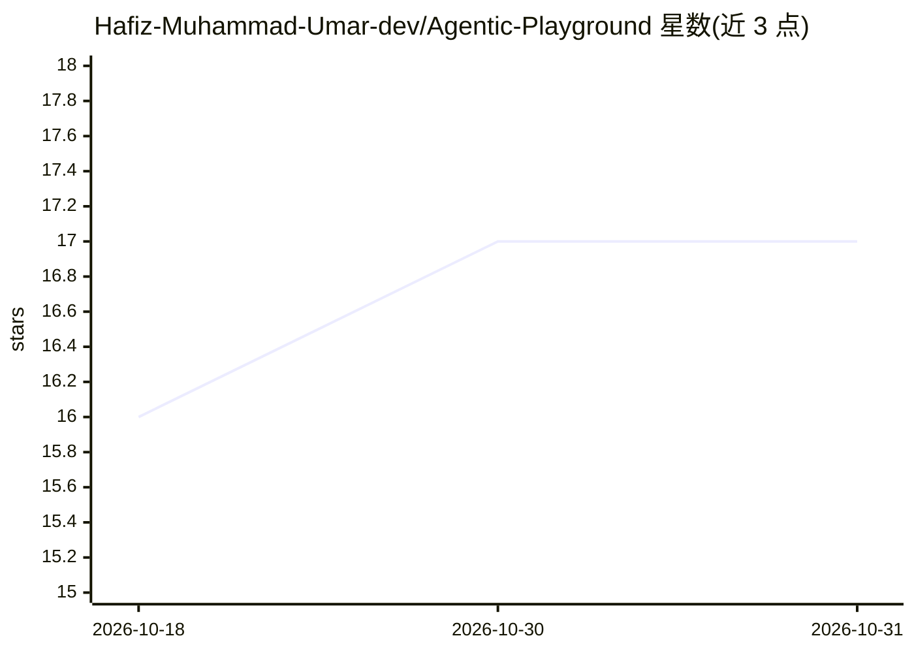

# Hafiz-Muhammad-Umar-dev/Agentic-Playground

⭐ 17 · Python · 推送 2026-08-02 · [GitHub](https://github.com/Hafiz-Muhammad-Umar-dev/Agentic-Playground) · 个人维护

**个人 Agentic AI 项目合集：多智能体、RAG 与自动化实验**

个人学习与作品集仓库，罗列十余个 Agentic AI 项目构想，覆盖研究/报告生成、GitHub PR 修复、代码审查、DevOps 自动化、邮箱管理、浏览器自动化、语音桌面助手等方向。技术栈列出 Next.js、FastAPI、LangChain、Qdrant、Neon Postgres 等，标注为 Planned/Used。仓库声明处于活跃开发扩张阶段，README 未给出安装或运行命令。

## 筛选速览

| 维度 | 判定 | 备注 |
|---|---|---|
| AI 角色 | `ai-knowledge` | 知识聚合/清单类 |
| 许可风险 | `none` | — |
| 部署形态 | `None` |  |
| 模型依赖 | — | README 未给出锁定关系 |
| 硬件要求 | — | 无带数字的原话,不猜 |
| 安装摩擦 | `low` | 无编译、无系统依赖或容器化 |
| 成熟度 | `idea` | |

## 能力要点

- 十余个 agent 项目构想，覆盖研究、工程、生产力与构建器四类
- 技术栈含 LangChain/Qdrant/OpenAI/Gemini（标注 Planned/Used）
- 声明持续新增 agent 构想，处于活跃开发期

## 适用场景

- 参考多智能体项目的分类与命名做自己的选题
- 了解 LangChain/Qdrant/Next.js/FastAPI 组合的技术栈清单

## 场景标签

`多智能体` `RAG` · 领域:Agent 开发

## 证据(README 行号)

> L3: A curated collection of **next-generation Agentic AI systems** designed to demonstrate autonomy, reasoning, automati
> L20: ### 🧠 Research & Knowledge Agents

## 星数曲线

2026-10-18 16 → 2026-10-31 17（+1）

---
*卡片 v1 · prompt 1.4 · 生成 2026-10-30 · 置信度 mid · 依据 README sha `f7ff77b19365` · [字段定义](../../DATASET.md)*
