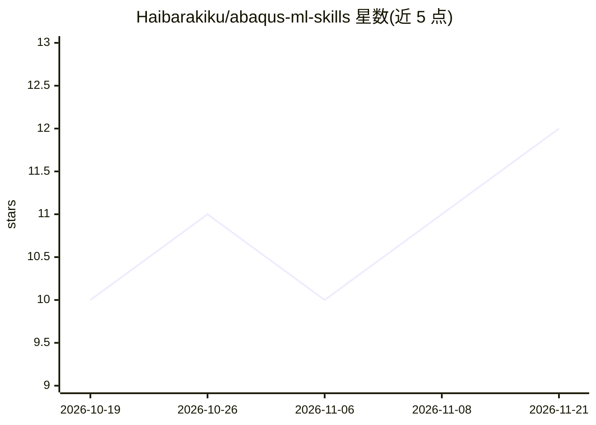

# Haibarakiku/abaqus-ml-skills

⭐ 12 · Python · MIT · 推送 2026-05-13 · [GitHub](https://github.com/Haibarakiku/abaqus-ml-skills) · 个人维护

**驱动 Abaqus FEA 到 ML 代理模型流水线的 Claude Code 技能包**

一组放入 .claude/skills/ 的 Claude Code agent 技能，覆盖三个环节：用拉丁超立方等采样生成参数化设计向量的 Abaqus 批量 FEA 数据集（含崩溃恢复与 dataset_index.csv）；将各案例 ODB 位移场重采样到规则 N×N 网格并输出 (X,Y) 宽表 CSV；以及在训练好的代理模型上做逆向求解并用 Abaqus 验证，报告四种逆解算子与多项误差指标。要求 PATH 中有 Abaqus 2021+，编排用 Python 3.8+，后处理依赖 numpy。

## 筛选速览

| 维度 | 判定 | 备注 |
|---|---|---|
| AI 角色 | `ai-ecosystem` | LLM/agent 周边工具 |
| 许可风险 | `permissive` | MIT |
| 部署形态 | `None` |  |
| 模型依赖 | — | README 未给出锁定关系 |
| 硬件要求 | — | 无带数字的原话,不猜 |
| 安装摩擦 | `low` | 无编译、无系统依赖或容器化 |
| 成熟度 | — | 结构信号不足 |

## 能力要点

- LHS 批量采样生成多案例 FEA 数据集，含批提交与崩溃恢复
- ODB 网格位移经分箱/双线性重采样转为 ML 就绪宽表 CSV
- 闭环逆设计验证：4 种逆解算子 + MSE/MAE/NRMSE 指标对比
- 设计维度 D 与网格 N 均参数化，无硬编码

## 适用场景

- 为代理模型批量生成数千个 FEA 训练样本
- 把成批 FEA 案例结果转成 Ridge/MLP/PyTorch 可用的训练矩阵
- 评估代理模型与真实 FEA 的差距后再用于逆设计

## 场景标签

`编码 Agent` `科研工具` · 领域:编码与开发

## 证据(README 行号)

> L3: Claude Code agent skills for **bridging Abaqus FEA and machine-learning surrogate models**. Drop these into `.claude
> L61: - Claude Code 2.x or any agent that supports the Agent Skills format

## 星数曲线

2026-10-19 10 → 2026-11-21 12（+2）

---
*卡片 v1 · prompt 1.4 · 生成 2026-11-19 · 置信度 high · 依据 README sha `a36d005bf0a6` · [字段定义](../../DATASET.md)*
