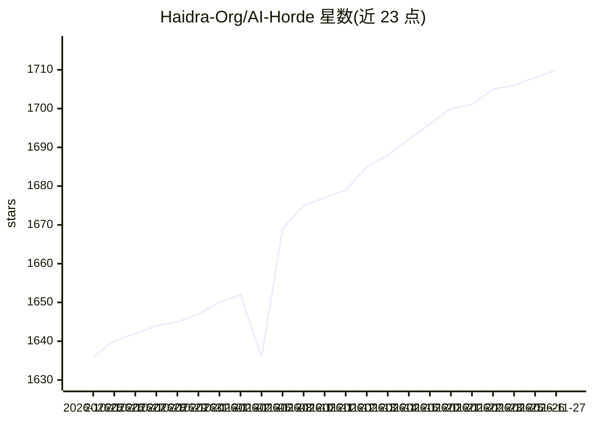

# Haidra-Org/AI-Horde

⭐ 1,710 · Python · AGPL-3.0 · 推送 2026-11-26 · [GitHub](https://github.com/Haidra-Org/AI-Horde) · 组织维护

**社区共享 GPU 的分布式图像与文本生成推理服务**

由志愿者运行的分布式推理集群：服务器接收图像/文本生成请求，路由到在线的志愿 GPU worker，收集结果并维护 kudos 积分账本；worker 贡献算力获得 kudos，可换取更高队列优先级。支持 Stable Diffusion、SDXL、Flux 等模型家族的文生图、img2img、inpainting，以及通过 OpenAI 兼容端点的流式聊天补全。由卢森堡注册非营利组织 Haidra 运营，匿名可免费使用，注册用户优先级更高；服务器可私有部署但需自备 worker。

## 筛选速览

| 维度 | 判定 | 备注 |
|---|---|---|
| AI 角色 | `ai-ecosystem` | LLM/agent 周边工具 |
| 许可风险 | `viral` | AGPL-3.0 |
| 部署形态 | `self-host` | docker 或自建部署 |
| 模型依赖 | — | README 未给出锁定关系 |
| 硬件要求 | — | 无带数字的原话,不猜 |
| 安装摩擦 | `low` | 无编译、无系统依赖或容器化 |
| 成熟度 | — | 结构信号不足 |

## 能力要点

- 志愿者 GPU 集群，worker 可随时加入/离开并动态路由
- OpenAI 兼容聊天端点（/v1/chat/completions、/v1/models）
- kudos 事件溯源账本，记录并审计每笔扣费与支付
- Docker Compose 全栈私有部署，GitHub Container Registry 提供镜像

## 适用场景

- 没有高性能 GPU 时通过网页免费生成图像和文本
- 为机器人/游戏/应用接入 Horde 的 REST API 或 OpenAI 兼容端点
- 团队/组织私有部署，汇集自有 GPU 做生成服务
- 贡献闲置 GPU 算力换取 kudos 提升自身请求优先级

## 场景标签

`图像生成` · 领域:内容生成

## 证据(README 行号)

> L14: The AI Horde is a free, community-run service for AI image generation and text generation. Volunteers run workers o
> L32: The AI Horde is a distributed inference service. The server queues requests, matches them to volunteer workers, col
> L53: The Horde has an OpenAI-compatible endpoint at `https://oai.aihorde.net/v1`. It supports `POST /v1/chat/completions

## 星数曲线

2026-10-25 1,636 → 2026-11-27 1,710（+74）

---
*卡片 v1 · prompt 1.4 · 生成 2026-11-23 · 置信度 high · 依据 README sha `4cee75225bcc` · [字段定义](../../DATASET.md)*
