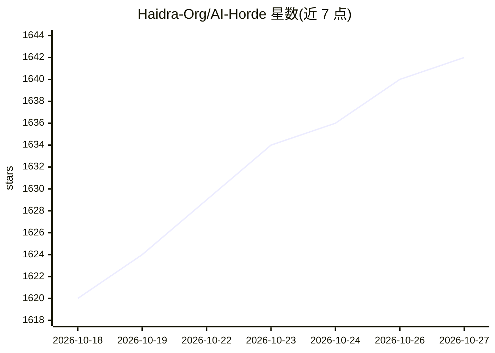

# Haidra-Org/AI-Horde

⭐ 1,642 · Python · AGPL-3.0 · 推送 2026-10-24 · [GitHub](https://github.com/Haidra-Org/AI-Horde) · 组织维护

**众包分布式 AI 推理集群中间件：志愿者共享算力生成图像与文本**

AI Horde 是一个社区驱动的众包分布式推理集群中间件，支持图像与文本生成任务的调度。志愿者通过运行 worker 贡献闲置 GPU 算力，系统以 kudos 积分（不可买卖）分配队列优先级，匿名用户也可通过 API key '0000000000' 免费使用。技术栈为 Python 3.9+、PostgreSQL、Redis，支持 Docker 容器化部署；既可作公共服务使用，也可在企业内私有化部署。第三方网站、游戏和应用可通过 REST API 接入。文本 worker 可通过 KoboldAI/KoboldCPP/Aphrodite 等后端桥接。

## 筛选速览

| 维度 | 判定 | 备注 |
|---|---|---|
| AI 角色 | `ai-ecosystem` | LLM/agent 周边工具 |
| 许可风险 | `viral` | AGPL-3.0 |
| 部署形态 | `None` |  |
| 模型依赖 | — | README 未给出锁定关系 |
| 硬件要求 | — | 无带数字的原话,不猜 |
| 安装摩擦 | `low` | 无编译、无系统依赖或容器化 |
| 成熟度 | — | 结构信号不足 |

## 能力要点

- 众包分布式推理中间件，同时支持图像与文本生成
- kudos 积分体系保障队列优先级公平性，积分不可买卖
- 支持匿名免费使用，第三方客户端经 REST API 接入
- 可私有化部署，支持 Docker 容器化

## 适用场景

- 没有高性能 GPU 的个人用户免费生成 AI 图像与文本
- 贡献闲置 GPU 算力并换取生成优先级
- 企业内部私有化部署分布式推理集群
- 第三方网站、游戏、应用经 REST API 集成生成能力

## 场景标签

`图像生成` `推理引擎` · 领域:内容生成

## 证据(README 行号)

> L19: The AI Horde is an enterprise-level ML-Ops crowd-sourced distributed inference cluster for AI Models. This middlewa
> L29: The public version allows individuals without powerful GPUs to use advanced AI models like Stable Diffusion or Larg

## 星数曲线

2026-10-18 1,620 → 2026-10-27 1,642（+22）

---
*卡片 v1 · prompt 1.4 · 生成 2026-10-21 · 置信度 high · 依据 README sha `d02697b23fb5` · [字段定义](../../DATASET.md)*
