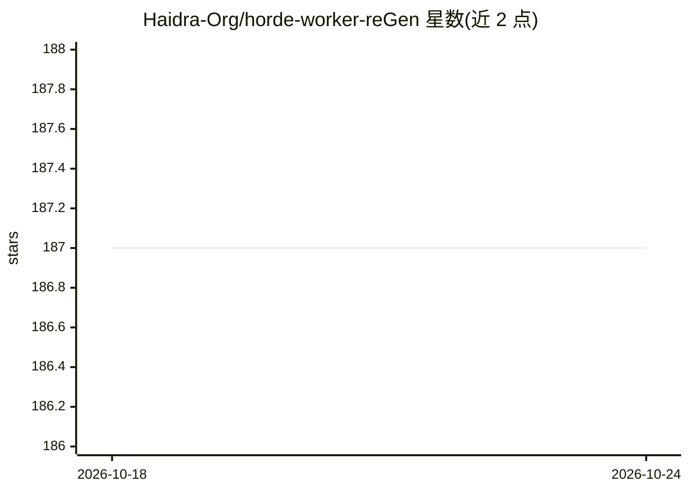

# Haidra-Org/horde-worker-reGen

⭐ 187 · Python · AGPL-3.0 · 推送 2026-05-06 · [GitHub](https://github.com/Haidra-Org/horde-worker-reGen) · [官网](https://aihorde.net/) · 组织维护

**AI Horde 众包网络的图像生成志愿 worker 客户端**

AI Horde 去中心化众包 AI 平台的官方 worker 客户端：在本地 GPU 上领取并执行图像生成等任务，完成后获得 kudos 奖励以提升自身请求的优先级。支持 NVIDIA、实验性的 AMD（仅 Linux/ROCm）与 DirectML 路径；通过 bridgeData.yaml 按 VRAM 分级配置；支持加载 SD1/2/SDXL/Stable Cascade/Flux.schnell 等基线的自定义模型，多 GPU 需每卡启动独立实例。以 git clone 或 zip 下载源码运行，另提供 Docker 镜像。

## 筛选速览

| 维度 | 判定 | 备注 |
|---|---|---|
| AI 角色 | `ai-ecosystem` | LLM/agent 周边工具 |
| 许可风险 | `viral` | AGPL-3.0 |
| 部署形态 | `self-host` | docker 或自建部署 |
| 模型依赖 | — | README 未给出锁定关系 |
| 硬件要求 | — | 无带数字的原话,不猜 |
| 安装摩擦 | `low` | 无编译、无系统依赖或容器化 |
| 成熟度 | `idea` | |

## 能力要点

- 领取 AI Horde 任务并在本地 GPU 生成图像，赚取 kudos
- 支持 SD1/SD2/SDXL/Stable Cascade/Flux.schnell 基线的自定义模型
- AMD ROCm 与 DirectML 实验性支持
- 提供 Docker 镜像与多 GPU 多实例运行方式

## 适用场景

- 捐献闲置 GPU 算力给 AI Horde 众包网络并赚取 kudos
- 以更高请求优先级换取自己的生图需求
- 用自有模型文件提供定制生成服务（需 customizer 角色）

## 场景标签

`图像生成` · 领域:内容生成

## 证据(README 行号)

> L3: Welcome to the AI Horde, a free and open decentralized platform for collaborative AI! The AI Horde enables people fr
> L5: A worker is a piece of software that handles jobs from the AI Horde, such as generating an image from a text prompt.

## 星数曲线

2026-10-18 187 → 2026-10-24 187（+0）

---
*卡片 v1 · prompt 1.4 · 生成 2026-10-22 · 置信度 high · 依据 README sha `133eccafd5d3` · [字段定义](../../DATASET.md)*
