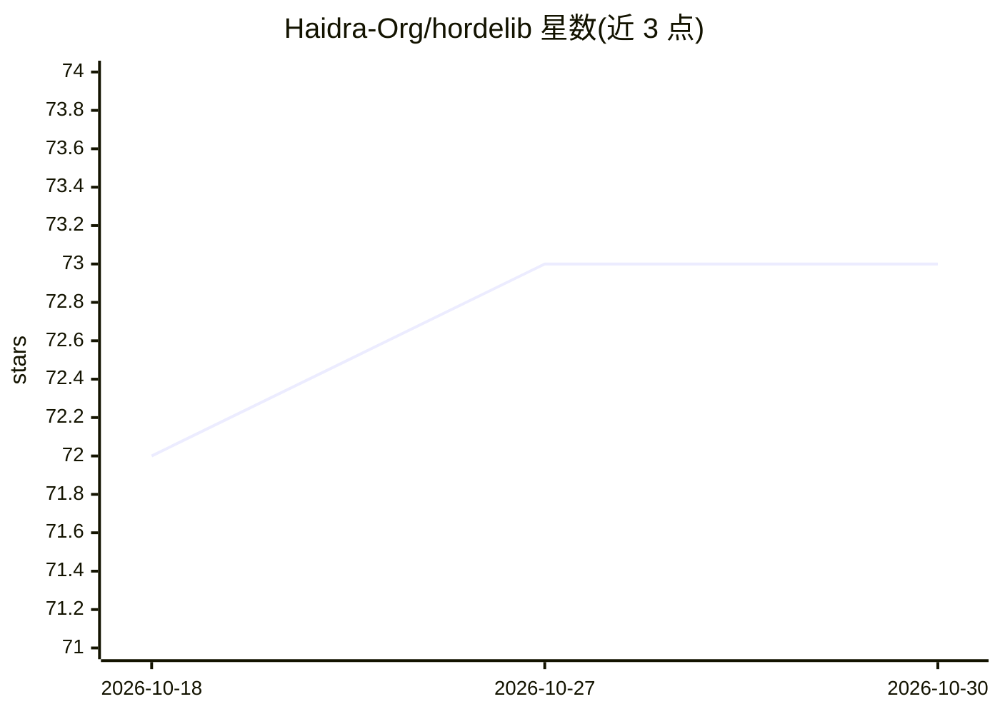

# Haidra-Org/hordelib

⭐ 73 · Python · AGPL-3.0 · 推送 2026-10-29 · [GitHub](https://github.com/Haidra-Org/hordelib) · [官网](https://hordelib.org) · 组织维护

**封装固定版本 ComfyUI，供 AI Horde 程序化运行推理管线**

horde-engine（Python 模块 hordelib）将一个固定 commit 的 ComfyUI 包装为可编程调用的推理后端，是 AI Horde v1.0.0 起的默认推理后端，面向 AI Horde worker 开发者。机制：initialise() 完成清单安装与 ComfyUI 导入，pydantic 类型化管线经注册表选择后生成 ComfyGraph 执行；模型由 SharedModelManager 下载校验。要求 Python>=3.12 与 NVIDIA GPU/CUDA，AMD 仅限 Linux ROCm，音频生成暂不支持。

## 筛选速览

| 维度 | 判定 | 备注 |
|---|---|---|
| AI 角色 | `ai-ecosystem` | LLM/agent 周边工具 |
| 许可风险 | `viral` | AGPL-3.0 |
| 部署形态 | `library` | 以包/库形式分发 |
| 模型依赖 | — | README 未给出锁定关系 |
| 硬件要求 | `cpu-ok` | |
| 安装摩擦 | `medium` | 含编译或系统依赖之一 |
| 成熟度 | — | 结构信号不足 |

## 能力要点

- 以 manifest 固定 ComfyUI commit 与外部自定义节点
- 类型化管线注册表：Selector 选择 PipelineDefinition 生成图执行
- 按类别管理模型下载/校验，支持 LoRA/TI adhoc 缓存
- 提供多 CUDA/ROCm/CPU 构建选择说明

## 适用场景

- 为 AI Horde worker 提供图像生成推理后端
- 在自有 GPU 机器上批量下载并管理 SD 模型
- 在 ComfyUI 中设计工作流后转为后端管线运行

## 场景标签

`图像生成` `推理引擎` · 领域:内容生成

## 证据(README 行号)

> L13: `horde-engine` wraps a pinned commit of ComfyUI so the AI Horde can run ComfyUI-designed inference pipelines progra
> L116: |**Public API**|`hordelib/api.py`|Declared consumer surface. Workers import from here only.|

## 星数曲线

2026-10-18 72 → 2026-10-30 73（+1）

---
*卡片 v1 · prompt 1.4 · 生成 2026-10-24 · 置信度 high · 依据 README sha `5ba4dddafc13` · [字段定义](../../DATASET.md)*
