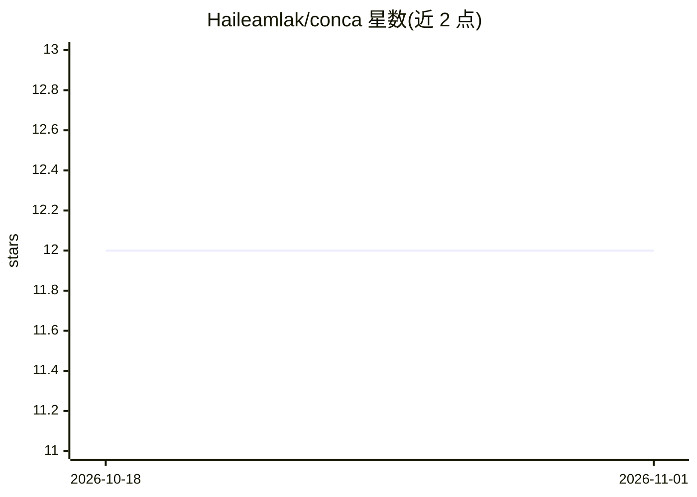

# Haileamlak/conca

⭐ 12 · TypeScript · 推送 2026-07-03 · [GitHub](https://github.com/Haileamlak/conca) · 个人维护

**自托管 AI 自主内容生成平台：多品牌运营社媒内容**

面向创作者和企业的自托管 AI 内容平台：通过 Plan→Generate→Evaluate→Publish 循环，将趋势研究转化为面向 LinkedIn 和 X 的优化内容，支持多品牌身份（AI 人设）管理与审批日历。集成 Gemini LLM 与 RAG 语义记忆，数据层支持 PostgreSQL 或本地 JSON。架构上由 React 仪表盘、Go 后端（Chi、JWT）与自主 agent 模块组成，需 Go 1.21+、Node.js 18+ 与 Gemini API Key，从源码克隆运行。

## 筛选速览

| 维度 | 判定 | 备注 |
|---|---|---|
| AI 角色 | `ai-native` | 本体是模型或模型工具 |
| 许可风险 | `none` | — |
| 部署形态 | `None` |  |
| 模型依赖 | — | README 未给出锁定关系 |
| 硬件要求 | — | 无带数字的原话,不猜 |
| 安装摩擦 | `low` | 无编译、无系统依赖或容器化 |
| 成熟度 | — | 结构信号不足 |

## 能力要点

- Plan→Generate→Evaluate→Publish 自主 agent 循环，持续研究与生成内容
- 多品牌身份（AI 人设）管理与内容审批、周历自动规划
- Gemini 驱动的 RAG 语义记忆，学习历史成功内容
- 支持 LinkedIn 与 X，含 REST API 与 JWT 认证

## 适用场景

- 为多个品牌自动生成并排期社媒内容
- 审阅和编辑 AI 生成内容后再发布
- 通过 API 触发自主生成周期并获取分析数据

## 场景标签

`AI 写作` · 领域:内容生成

## 证据(README 行号)

> L3: **Conca** is an autonomous, self-hosted AI content platform designed for modern creators and enterprises. It transfo
> L7: - **Autonomous Agent Loop**: Continuous research and generation cycles powered by Gemini LLM.

## 星数曲线

2026-10-18 12 → 2026-11-01 12（+0）

---
*卡片 v1 · prompt 1.4 · 生成 2026-11-01 · 置信度 high · 依据 README sha `a4ae9251ca4a` · [字段定义](../../DATASET.md)*
