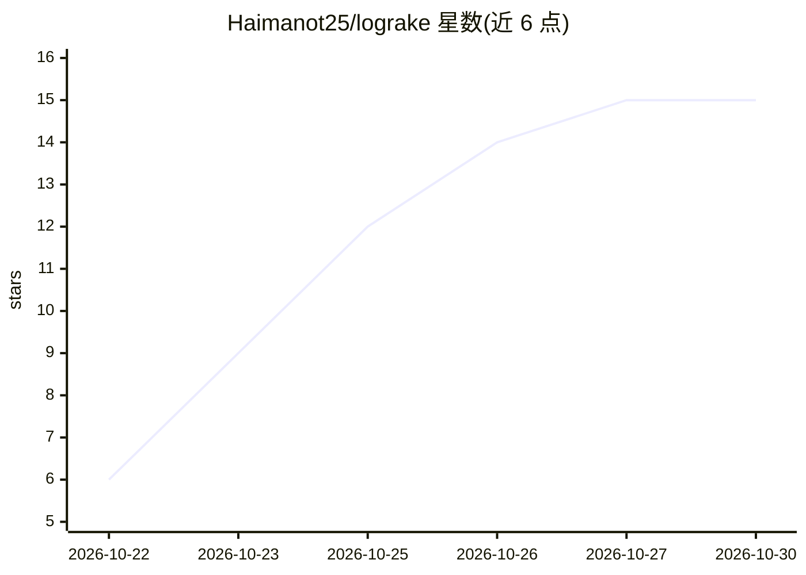

# Haimanot25/lograke

⭐ 15 · JavaScript · MIT · 推送 2026-10-25 · [GitHub](https://github.com/Haimanot25/lograke) · [官网](https://www.npmjs.com/package/lograke) · 个人维护

**自适应日志分析平台：解析、搜索、可视化日志并提供 AI 洞察**

基于 Node.js/Express + React 19 的开源日志分析平台，自动检测并解析任意格式的日志文件，无需自定义解析器。功能含模式检测、异常检测、实体追踪关联、实时 SSE 日志尾随、交互式仪表盘与告警规则。AI 部分为多提供商 Copilot（Groq/Gemini/Grok/Ollama），可用自然语言询问日志。内置 JWT 认证、RBAC、SSRF 防护与速率限制；提供 npx、源码与 Docker Compose 三种运行方式。

## 筛选速览

| 维度 | 判定 | 备注 |
|---|---|---|
| AI 角色 | `ai-enhanced` | 去掉 AI 部分产品仍成立 |
| 许可风险 | `permissive` | MIT |
| 部署形态 | `self-host` | docker 或自建部署 |
| 模型依赖 | local-ok | 支持本地模型 |
| 硬件要求 | — | 无带数字的原话,不猜 |
| 安装摩擦 | `low` | 无编译、无系统依赖或容器化 |
| 成熟度 | — | 结构信号不足 |

## 能力要点

- 自动检测解析任意日志格式，无需自定义解析器
- AI Copilot 支持 Groq/Gemini/Grok/Ollama 多提供商
- 模式/异常检测、实体图可视化与实时日志尾随（SSE）
- JWT 认证、RBAC、SSRF 防护与速率限制等安全机制

## 适用场景

- 上传或粘贴日志文件做解析、过滤与正则搜索
- 通过仪表盘查看日志模式、异常与实体关联
- 用自然语言向 AI Copilot 询问日志问题
- 导出分析结果为 JSON/CSV/Markdown

## 场景标签

`数据分析` · 领域:效率与自动化

## 证据(README 行号)

> L8: Lograke is an enterprise-grade, open-source log analysis platform that automatically parses, analyzes, and visualize
> L21: - **AI-Powered Insights**: Multi-provider support (Groq free, Gemini, Grok, Ollama local)
> L176: 5. **AI Copilot**: Ask natural language questions about your logs

## 星数曲线

2026-10-22 6 → 2026-10-30 15（+9）

---
*卡片 v1 · prompt 1.4 · 生成 2026-10-30 · 置信度 high · 依据 README sha `ec4a7ab6229f` · [字段定义](../../DATASET.md)*
