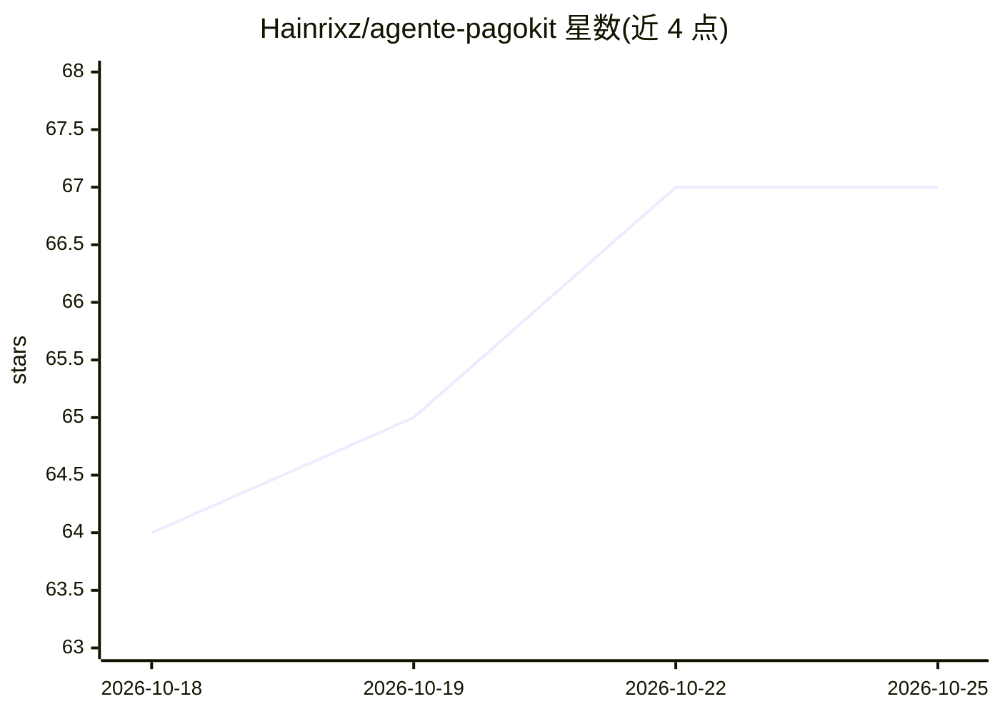

# Hainrixz/agente-pagokit

⭐ 67 · JavaScript · MIT · 推送 2026-08-31 · [GitHub](https://github.com/Hainrixz/agente-pagokit) · [官网](https://tododeia.com) · 个人维护

**Claude Code 支付集成插件：选型并生成支付代码，带安全校验器**

以 Claude Code 插件形式运行的支付集成代理：扫描项目栈（package.json、路由、DB schema），询问最多五个问题后运行确定性排序引擎，从 42 个支付服务提供商、136 种支付方式中推荐并生成完整集成（前端、结账端点、webhook、迁移、退款路径等）。三个确定性引擎负责校验、排序与事件签名；hook 校验器拦截不安全写入（无签名验证的 webhook、零小数货币乘 100 等），每次绕过记录到审计日志。全部本地运行，无需账号或 API key。要求 Node.js ≥ 18 与 Claude Code 2.x。

## 筛选速览

| 维度 | 判定 | 备注 |
|---|---|---|
| AI 角色 | `ai-ecosystem` | LLM/agent 周边工具 |
| 许可风险 | `permissive` | MIT |
| 部署形态 | `library` | 以包/库形式分发 |
| 模型依赖 | — | README 未给出锁定关系 |
| 硬件要求 | — | 无带数字的原话,不猜 |
| 安装摩擦 | `low` | 无编译、无系统依赖或容器化 |
| 成熟度 | — | 结构信号不足 |

## 能力要点

- 42 个提供商、136 种支付方式、74 个国家的目录与确定性排序引擎
- PreToolUse/PostToolUse hook 校验器拦截不安全支付代码写入
- 签名方案未验证的提供商不生成签名校验器，改输出 TODO
- 支持有效/伪造/重放三类 webhook 事件本地测试

## 适用场景

- 为我的应用选择并生成合适的支付网关集成代码
- 审计已有支付集成的签名验证与密钥安全
- 拉美等本地支付轨道（Pix、PSE、Bizum 等）的集成实现

## 场景标签

`代码生成` · 领域:编码与开发

## 证据(README 行号)

> L5: Claude Code Plugin
> L132: claude --plugin-dir ~/agente-pagokit
> L42: |**Validators**|Node checks on `PreToolUse` / `PostToolUse` hooks that **block** an insecure write|The model cannot

## 星数曲线

2026-10-18 64 → 2026-10-25 67（+3）

---
*卡片 v1 · prompt 1.4 · 生成 2026-10-24 · 置信度 mid · 依据 README sha `58d6d06f88fd` · [字段定义](../../DATASET.md)*
