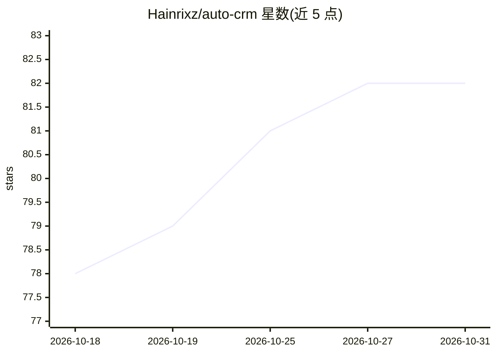

# Hainrixz/auto-crm

⭐ 82 · TypeScript · MIT · 推送 2026-10-25 · [GitHub](https://github.com/Hainrixz/auto-crm) · [官网](https://www.tododeia.com/) · 个人维护

**本地自托管的 AI CRM：通过 Claude Code 自动适配业务**

基于 Next.js/React/SQLite/Drizzle ORM 的开源 CRM，数据全部保存在本机，功能含仪表盘 KPI、看板 Pipeline、联系人管理（lead 评分与温度）、活动时间线、Webhook 接收表单线索、CSV 导出、邮件日报等。AI 部分依赖 Claude 生态：用 Claude Code 执行 /setup 等 8 个命令自动定制行业/pipeline/语言主题，内置 MCP 服务器供 Claude Desktop 直接操作 CRM；Web 端 lead 分类可用规则模式（无需 API key）或可选的 Claude API。Docker 与 npm 均可部署。

## 筛选速览

| 维度 | 判定 | 备注 |
|---|---|---|
| AI 角色 | `ai-enhanced` | 去掉 AI 部分产品仍成立 |
| 许可风险 | `permissive` | MIT |
| 部署形态 | `self-host` | docker 或自建部署 |
| 模型依赖 | locked-api |  |
| 硬件要求 | — | 无带数字的原话,不猜 |
| 安装摩擦 | `low` | 无编译、无系统依赖或容器化 |
| 成熟度 | — | 结构信号不足 |

## 能力要点

- 100% 本地运行，SQLite 存储，无外部服务依赖
- 8 个 Claude Code 命令（/setup、/add-lead、/analyze-pipeline 等）自动定制 CRM
- 内置 MCP 服务器，可从 Claude Desktop/Web 直接查询和操作 CRM
- Webhook 接收 Typeform/Tally 等表单线索，支持西/英文字段

## 适用场景

- 不想用 Salesforce/HubSpot 订阅制的小团队本地管理客户与商机
- 通过对话式命令让 Claude Code 添加线索、分析 pipeline
- 用表单 webhook 自动收集销售线索并本地化跟进

## 场景标签

 · 领域:销售/CRM 应用

## 证据(README 行号)

> L22: Auto-CRM es un CRM open-source que se personaliza automaticamente a tu negocio. Abrelo con Claude Code, ejecuta `/s
> L81: Dos modos: reglas automaticas (sin API key) o IA con Claude (opcional). Score de 0-100 y temperatura automatica.
> L198: |Modo|Requiere API Key|Como funciona|

## 星数曲线

2026-10-18 78 → 2026-10-31 82（+4）

---
*卡片 v1 · prompt 1.4 · 生成 2026-10-24 · 置信度 high · 依据 README sha `af56bf383c6b` · [字段定义](../../DATASET.md)*
