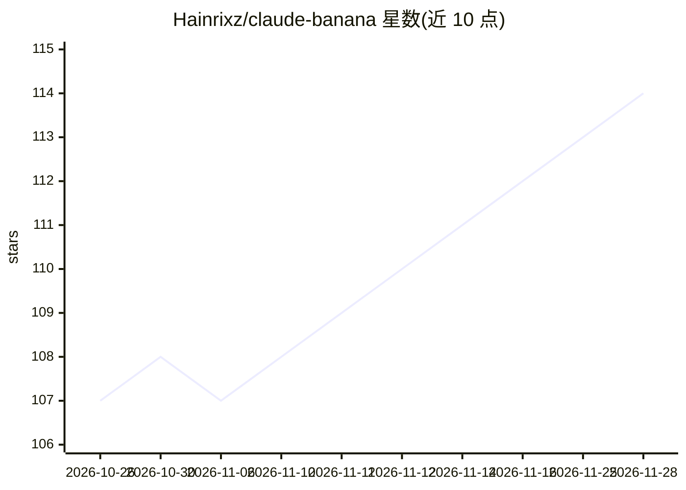

# Hainrixz/claude-banana

⭐ 114 · Python · MIT · 推送 2026-10-25 · [GitHub](https://github.com/Hainrixz/claude-banana) · [官网](https://www.tododeia.com) · 个人维护

**基于 Claude Code 的图像生成提示词编写 agent**

该项目是一个运行在 Claude Code 之上的 prompt-architect agent 与知识库：用户用日常语言描述想要的图像，agent 通过提问澄清需求，按 7 要素公式（主体/风格/环境/光照/动作/镜头/质感）生成可直接粘贴给图像生成器的提示词。内置 9 个领域模式、70+ 创意技法参考、25 个提示词模板与品牌风格预设。使用前需安装 Claude Code，通过 git clone 下载后在项目目录启动 claude 即可加载；可选配置 Google AI API key 在终端直接生成图像。

## 筛选速览

| 维度 | 判定 | 备注 |
|---|---|---|
| AI 角色 | `ai-native` | 本体是模型或模型工具 |
| 许可风险 | `permissive` | MIT |
| 部署形态 | `None` |  |
| 模型依赖 | — | README 未给出锁定关系 |
| 硬件要求 | — | 无带数字的原话,不猜 |
| 安装摩擦 | `low` | 无编译、无系统依赖或容器化 |
| 成熟度 | — | 结构信号不足 |

## 能力要点

- 7 要素公式生成结构化图像提示词
- 9 个领域模式（电影/产品/人像/UI 等）与 70+ 创意技法知识库
- 可将 Midjourney/DALL-E/Stable Diffusion 既有提示词转换适配 Nano Banana Pro
- 提供 25 个模板、品牌预设及可选的终端直出图像 Python 脚本

## 适用场景

- 为图像生成器写出细节完整的提示词
- 把已有的 Midjourney/DALL-E 提示词转换成 Nano Banana Pro 可用的版本
- 按品牌色板与风格批量生成一致风格的图像提示词

## 场景标签

`提示工程` `图像生成` · 领域:Agent 开发

## 证据(README 行号)

> L15: Claude Banana is your **creative assistant**. You describe what you want in plain words, and it:
> L48: Claude automatically picks up the prompt-architect agent and knowledge base from this project. It will ask you a co

## 星数曲线

2026-10-26 107 → 2026-11-28 114（+7）

---
*卡片 v1 · prompt 1.4 · 生成 2026-11-28 · 置信度 high · 依据 README sha `287b13352169` · [字段定义](../../DATASET.md)*
