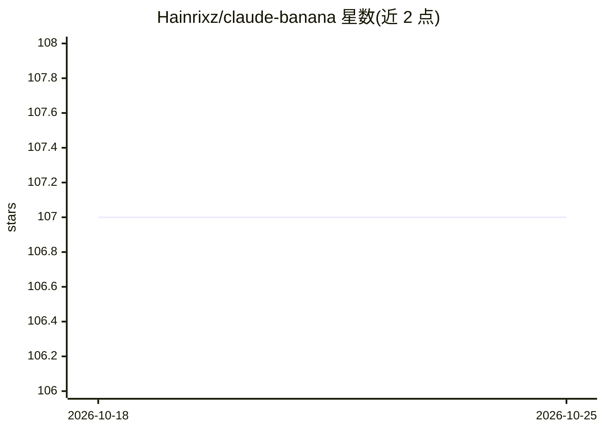

# Hainrixz/claude-banana

⭐ 107 · Python · MIT · 推送 2026-03-25 · [GitHub](https://github.com/Hainrixz/claude-banana) · [官网](https://www.tododeia.com) · 个人维护

**Claude Code agent：把口语想法转成图像生成提示词**

面向图像生成用户的项目：以 Claude Code 为运行环境，通过提问澄清需求后，按 7 要素公式（主体/风格/环境/光线/动作/机位/质感）生成可粘贴到图像生成器的提示词，含 9 种领域模式与 70+ 创意技法，可将 Midjourney/DALL-E/Stable Diffusion 既有提示词转换为适配 Nano Banana Pro 的版本，另附 25 个模板与品牌预设。可选配合 Google AI API key 在终端直接生图，需先安装 Claude Code 并 git clone 本项目。

## 筛选速览

| 维度 | 判定 | 备注 |
|---|---|---|
| AI 角色 | `ai-native` | 本体是模型或模型工具 |
| 许可风险 | `permissive` | MIT |
| 部署形态 | `None` |  |
| 模型依赖 | — | README 未给出锁定关系 |
| 硬件要求 | — | 无带数字的原话,不猜 |
| 安装摩擦 | `low` | 无编译、无系统依赖或容器化 |
| 成熟度 | — | 结构信号不足 |

## 能力要点

- 7 要素提示词公式与 9 种领域模式
- 70+ 创意技法（动漫化、微缩世界、像素图标等）
- 转换既有 Midjourney/DALL-E/SD 提示词适配 Nano Banana Pro
- 25 个可定制模板与品牌风格预设

## 适用场景

- 我想让 AI 画图但不会写详细提示词
- 把已有的 Midjourney/SD 提示词改写适配 Nano Banana Pro
- 为品牌保持系列图片的风格一致

## 场景标签

`提示工程` · 领域:Agent 开发

## 证据(README 行号)

> L3: **You tell it what picture you want. It writes the perfect instructions to make that picture.**
> L18: 2. **Builds a detailed, optimized prompt** using a proven formula
> L48: Claude automatically picks up the prompt-architect agent and knowledge base from this project. It will ask you a co

## 星数曲线

2026-10-18 107 → 2026-10-25 107（+0）

---
*卡片 v1 · prompt 1.4 · 生成 2026-10-23 · 置信度 high · 依据 README sha `81d69bd59987` · [字段定义](../../DATASET.md)*
