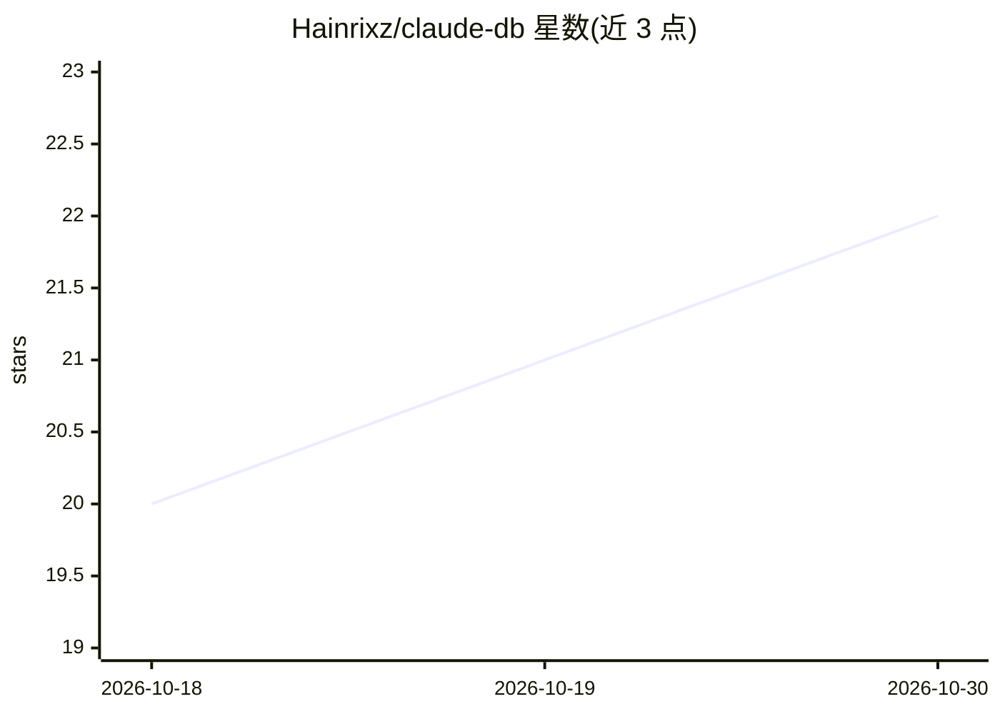

# Hainrixz/claude-db

⭐ 22 · JavaScript · MIT · 推送 2026-10-25 · [GitHub](https://github.com/Hainrixz/claude-db) · [官网](https://tododeia.com) · 个人维护

**Claude Code 的多范式数据库设计/审计/迁移插件，离线可用**

面向 Claude Code 的技能插件（也支持 Cursor、Codex 等 via Vercel Skills），覆盖 SQL、文档、键值、向量、时序、图等范式。功能：从需求推荐引擎并起草 schema，对现有 schema 做审计，在两个独立维度打分，23 个审计模块（M0–M22）并行执行，发现附带证据与可复现验证命令。默认 Tier 0 完全离线审计文件；Tier 1/2 可选接入只读数据库连接做实况内省。修复操作需用户逐项确认，Claude 不能自行触发写入。

## 筛选速览

| 维度 | 判定 | 备注 |
|---|---|---|
| AI 角色 | `ai-ecosystem` | LLM/agent 周边工具 |
| 许可风险 | `permissive` | MIT |
| 部署形态 | `library` | 以包/库形式分发 |
| 模型依赖 | locked-api |  |
| 硬件要求 | — | 无带数字的原话,不猜 |
| 安装摩擦 | `low` | 无编译、无系统依赖或容器化 |
| 成熟度 | — | 结构信号不足 |

## 能力要点

- Design & Integrity 与 Performance & Scale 两个 0–100 独立评分
- 23 个只读审计模块（M0–M22），发现附带证据与验证命令
- Tier 0 完全离线，无需 API key；Tier 1/2 可选实况内省（只读契约）
- 支持关系、文档、键值、宽列、向量、时序、图 7 种范式，按范式切换评分权重

## 适用场景

- 新项目里让 Claude Code 推荐数据库引擎并起草 schema
- 对现有 schema/迁移/ORM 文件做离线审计并获得优先级修复建议
- 让 Claude 生成可逆、锁感知的迁移文件并逐项确认后应用

## 场景标签

`代码审查` · 领域:编码与开发

## 证据(README 行号)

> L9:  Claude Code plugin
> L68: A skill-first, three-layer design (Claude is the runtime; the Node/Python helpers are optional):
> L36: **Cross-agent** (Cursor, Codex, Gemini CLI, Windsurf…) via Vercel Skills:

## 星数曲线

2026-10-18 20 → 2026-10-30 22（+2）

---
*卡片 v1 · prompt 1.4 · 生成 2026-10-28 · 置信度 high · 依据 README sha `0516e98c47dd` · [字段定义](../../DATASET.md)*
