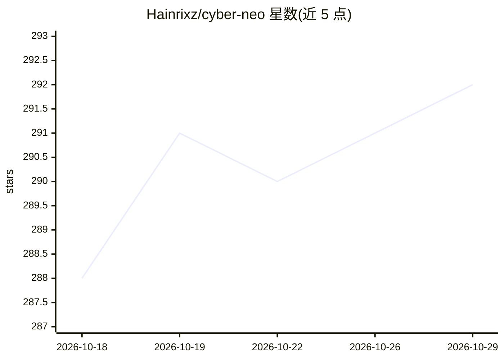

# Hainrixz/cyber-neo

⭐ 292 · Python · MIT · 推送 2026-10-25 · [GitHub](https://github.com/Hainrixz/cyber-neo) · [官网](https://tododeia.com) · 组织维护

**运行于 Claude Code 内的安全审计 agent：扫描 OWASP/CWE 漏洞并生成报告**

以 Claude Code skill（SKILL.md 编排提示词）形式交付的网络安全分析 agent：对指定项目执行 7 阶段审计流水线，覆盖 11 个安全域（SAST、认证授权、加密、密钥检测 60+ 正则模式、依赖 CVE、供应链、CI/CD、容器等），通过 5 个并行 subagent 分析，映射全部 OWASP 2025 Top 10 与 15+ 项 CWE Top 25，按 CVSS 对齐评分，将 Markdown 报告写入桌面。辅以两个零依赖 Python 脚本处理批量扫描，遵循只读铁律（不修改文件、不执行代码）。Semgrep/Trivy/Gitleaks 等外部工具为可选集成。

## 筛选速览

| 维度 | 判定 | 备注 |
|---|---|---|
| AI 角色 | `ai-native` | 本体是模型或模型工具 |
| 许可风险 | `permissive` | MIT |
| 部署形态 | `library` | 以包/库形式分发 |
| 模型依赖 | locked-api |  |
| 硬件要求 | — | 无带数字的原话,不猜 |
| 安装摩擦 | `low` | 无编译、无系统依赖或容器化 |
| 成熟度 | — | 结构信号不足 |

## 能力要点

- 11 个安全域、覆盖全部 OWASP 2025 Top 10 与 15+ 项 CWE Top 25
- 5 个并行 subagent 的 7 阶段分析流水线
- 60+ 正则模式的密钥检测脚本与 10 种包管理器的锁文件校验脚本（零第三方依赖）
- 只读铁律：不修改文件、不执行代码、报告中密钥脱敏

## 适用场景

- 在 Claude Code 中对本地项目做一次性安全审计
- 扫描代码与依赖中的注入、弱加密、硬编码密钥等漏洞
- 生成按 CVSS 评分排序、含修复示例的安全报告

## 场景标签

`网络安全` · 领域:学习与行业

## 证据(README 行号)

> L20: **Cyber Neo** is a comprehensive cybersecurity analysis agent that runs inside Claude Code. Point it at any project
> L176: Cyber Neo is built as a Claude Code **skill** — a markdown-based prompt that orchestrates Claude's analysis capabi

## 星数曲线

2026-10-18 288 → 2026-10-29 292（+4）

---
*卡片 v1 · prompt 1.4 · 生成 2026-10-22 · 置信度 mid · 依据 README sha `efc9b5ab4365` · [字段定义](../../DATASET.md)*
