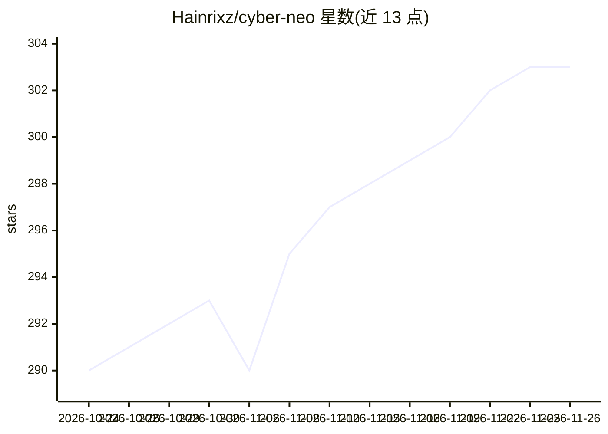

# Hainrixz/cyber-neo

⭐ 303 · Python · MIT · 推送 2026-10-25 · [GitHub](https://github.com/Hainrixz/cyber-neo) · [官网](https://tododeia.com)

**在 Claude Code 中运行的网络安全审计 agent，扫描项目漏洞并生成报告**

以 Claude Code skill 形式分发的安全分析 agent：对指定项目执行 7 阶段分析流水线，覆盖 11 个安全域（SAST、认证授权、加密、密钥泄露、依赖 CVE、Web、供应链、CI/CD、Docker、错误处理、日志），映射 OWASP 2025 Top 10 与 CWE Top 25，输出带 CVSS 对齐严重度评分的 Markdown 报告到桌面。内置 14 个参考文件与两个仅用标准库的 Python 脚本，5 个并行 subagent 加速；强制只读约束，不修改、不执行、不安装。

## 筛选速览

| 维度 | 判定 | 备注 |
|---|---|---|
| AI 角色 | `ai-native` | 本体是模型或模型工具 |
| 许可风险 | `permissive` | MIT |
| 部署形态 | `library` | 以包/库形式分发 |
| 模型依赖 | — | README 未给出锁定关系 |
| 硬件要求 | — | 无带数字的原话,不猜 |
| 安装摩擦 | `low` | 无编译、无系统依赖或容器化 |
| 成熟度 | — | 结构信号不足 |

## 能力要点

- 11 个安全域扫描，覆盖 OWASP 2025 Top 10 全部类别与 15+ CWE Top 25 条目
- 60+ regex 密钥泄露模式，覆盖 AWS/GCP/Azure/GitHub/Slack/Stripe 等
- 5 个并行 subagent，按项目规模分 3 级扫描策略
- 只读铁律：不改文件、不执行代码，仅写出报告

## 适用场景

- 发布前对自己的应用做一次安全审计
- 检查仓库里是否误提交了 API 密钥等凭据
- 审查依赖与 CI/CD 流水线中的供应链风险

## 场景标签

`网络安全` `代码审查` · 领域:编码与开发

## 证据(README 行号)

> L20: **Cyber Neo** is a comprehensive cybersecurity analysis agent that runs inside Claude Code. Point it at any project
> L63: - **All 10 OWASP 2025 Top 10 categories** — including the two new entries: *A03 Software Supply Chain Failures* and
> L176: Cyber Neo is built as a Claude Code **skill** — a markdown-based prompt that orchestrates Claude's analysis capabi

## 星数曲线

2026-10-24 290 → 2026-11-26 303（+13）

---
*卡片 v1 · prompt 1.4 · 生成 2026-11-25 · 置信度 mid · 依据 README sha `7b3fbd23bc1a` · [字段定义](../../DATASET.md)*
