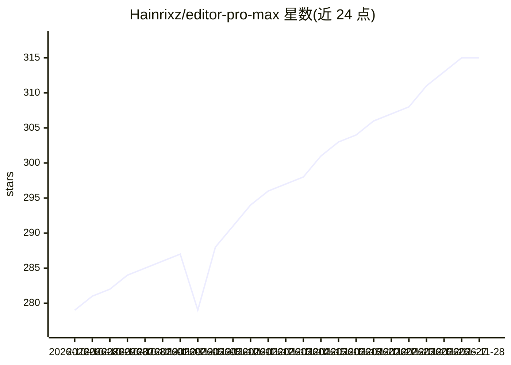

# Hainrixz/editor-pro-max

⭐ 315 · TypeScript · NOASSERTION · 推送 2026-10-25 · [GitHub](https://github.com/Hainrixz/editor-pro-max) · [官网](https://www.tododeia.com) · 个人维护

**让 Claude Code 成为视频编辑器：自然语言生成 MP4**

该项目把 Claude Code 接入 Remotion 视频渲染流程：用户用自然语言描述需求，由 Claude 编写 React 组件组合，通过 Remotion 渲染为 MP4。提供 25 个组件（文字动画、背景、overlay、布局、转场）、10 个平台模板（TikTok/Instagram/YouTube/演示等）与 5 个管线脚本（视频分析、音频提取、Whisper 转录、静音检测、背景去除）。全程本地运行，无需 API key，需 Node.js 20+ 与已安装的 Claude Code CLI；Windows 需 WSL。

## 筛选速览

| 维度 | 判定 | 备注 |
|---|---|---|
| AI 角色 | `ai-native` | 本体是模型或模型工具 |
| 许可风险 | `none` | NOASSERTION |
| 部署形态 | `library` | 以包/库形式分发 |
| 模型依赖 | — | README 未给出锁定关系 |
| 硬件要求 | — | 无带数字的原话,不猜 |
| 安装摩擦 | `medium` | 含编译或系统依赖之一 |
| 成熟度 | — | 结构信号不足 |

## 能力要点

- 自然语言描述 → Claude 写 React 组合 → Remotion 渲染 MP4
- 25 个可复用组件、10 个平台模板、12 种转场预设
- 5 个管线脚本：Whisper 词级字幕、静音检测、背景去除
- 本地运行，无 GUI 与导出配置，无需 API key

## 适用场景

- 给课程或产品快速生成社交平台宣传视频
- 给口播视频自动加词级字幕并剪掉静音
- 从长录像中裁剪出适合 Instagram 的 30 秒片段
- 按 TikTok/YouTube 等平台尺寸渲染同一内容的多版本

## 场景标签

`语音识别` `视频生成` · 领域:内容生成

## 证据(README 行号)

> L15: Editor Pro Max turns Claude Code into a professional video editor. Instead of dragging clips on a timeline, you des
> L17: No GUI to learn. No export settings to configure. No API keys needed. Everything runs locally on your machine.
> L128: |Whisper.cpp|Local AI transcription (word-level timestamps)|

## 星数曲线

2026-10-26 279 → 2026-11-28 315（+36）

---
*卡片 v1 · prompt 1.4 · 生成 2026-11-25 · 置信度 high · 依据 README sha `08e5cc8ca5b7` · [字段定义](../../DATASET.md)*
