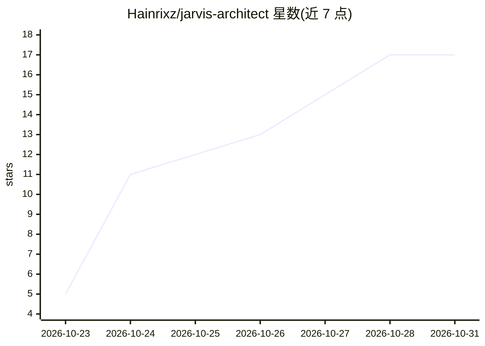

# Hainrixz/jarvis-architect

⭐ 17 · JavaScript · MIT · 推送 2026-10-25 · [GitHub](https://github.com/Hainrixz/jarvis-architect) · [官网](https://tododeia.com) · 个人维护

**Claude Code 插件：通过面试为你选定运行时/模型/托管并搭建个人 AI 助手**

以 Claude Code 插件或克隆仓库方式运行的向导型工具：通过 20-40 分钟的对话面试了解用户职业与需求，按书面决策树从 9 个运行时（Claude Code、Hermes、OpenClaw、Codex、Ollama、Agent SDK、Cowork 等）中选定运行时、模型、托管方式与渠道，并陪同安装至助手可用。产出的 Jarvis 具备 markdown 记忆文件（SOUL.md/MEMORY.md 等）、MCP 工具接入、Telegram/WhatsApp 等渠道、本地 Web 面板、分级自治任务（L0-L3）与学习机制；发送/支付/删除等不可逆操作需用户批准。使用前需 Claude Code 与 Claude 账号或 API key，无订阅时搭建成本约 5-20 美元一次。

## 筛选速览

| 维度 | 判定 | 备注 |
|---|---|---|
| AI 角色 | `ai-ecosystem` | LLM/agent 周边工具 |
| 许可风险 | `permissive` | MIT |
| 部署形态 | `None` |  |
| 模型依赖 | locked-api |  |
| 硬件要求 | — | 无带数字的原话,不猜 |
| 安装摩擦 | `medium` | 含编译或系统依赖之一 |
| 成熟度 | — | 结构信号不足 |

## 能力要点

- 面试式决策：按书面决策树从 9 个运行时中选定并说明理由
- 产出可迁移的 markdown 记忆文件与 RUNBOOK.md/SECURITY.md
- L0-L3 四级自治：每日三次试点任务，不可逆操作需 5 分钟内有效的批准
- 本地 Web 面板（仅监听 127.0.0.1）管理与审批助手行为

## 适用场景

- 不会选型的用户让向导代为决定运行时、模型与托管并搭好个人助手
- 通过 Telegram/WhatsApp 等渠道获得定时摘要、任务跟进等日常辅助
- 在权限审批约束下让助手自动准备草稿与提醒

## 场景标签

`AI 助手` · 领域:对话与助手

## 证据(README 行号)

> L13: Jarvis Architect hace esas elecciones por ti: te entrevista sobre tu trabajo, escoge runtime, modelo, hosting, cana
> L101:  Runtime elegido para ti Uno de nueve (Claude Code, Hermes, OpenClaw, Codex, Ollama, Agent SDK, Cowork…), con la v

## 星数曲线

2026-10-23 5 → 2026-10-31 17（+12）

---
*卡片 v1 · prompt 1.4 · 生成 2026-10-30 · 置信度 high · 依据 README sha `a55c1fd77ded` · [字段定义](../../DATASET.md)*
