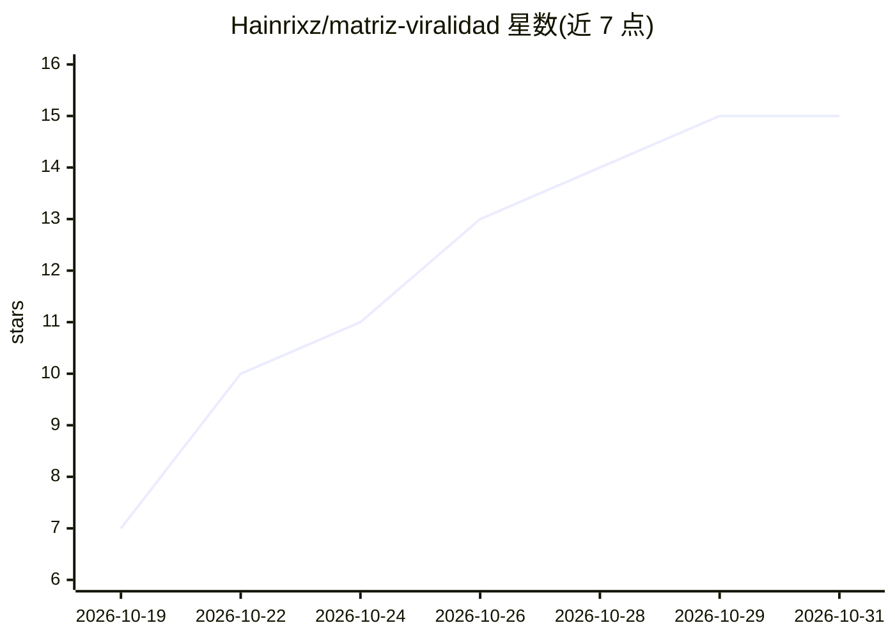

# Hainrixz/matriz-viralidad

⭐ 15 · JavaScript · MIT · 推送 2026-10-25 · [GitHub](https://github.com/Hainrixz/matriz-viralidad) · [官网](https://www.tododeia.com/community/matriz-viral) · 个人维护 · 中文 README

**Claude Code 内容分析 agent：抓取公开短视频账号，生成病毒式传播矩阵与脚本**

运行在 Claude Code 内的 agent（可克隆仓库或插件方式安装），面向短视频内容创作者。用 Apify 抓取 Instagram/TikTok/YouTube/X 公开账号的视频，通过 Gemini 音频、watch 技能或本地 ffmpeg 帧分析三条路径观看视频，构建 10 列病毒式传播矩阵（以各账号播放量中位数为基准计算表现倍数），提炼重复模式并生成 5 个新脚本及模拟评估。每次运行有美元硬性支出上限，由独立校验 agent 审计矩阵。支持西语/英语交互，需 Node 20 与 Apify 账号，macOS 已测试，Windows 未测试。

## 筛选速览

| 维度 | 判定 | 备注 |
|---|---|---|
| AI 角色 | `ai-native` | 本体是模型或模型工具 |
| 许可风险 | `permissive` | MIT |
| 部署形态 | `None` |  |
| 模型依赖 | locked-api |  |
| 硬件要求 | — | 无带数字的原话,不猜 |
| 安装摩擦 | `medium` | 含编译或系统依赖之一 |
| 成熟度 | — | 结构信号不足 |

## 能力要点

- 10 列传播矩阵，以账号中位数计算 RENDIMIENTO 倍数
- 三条视频分析路径：Gemini 音频 / watch 技能 / 本地 ffmpeg 帧
- Apify 抓取每次运行带美元硬上限与实际花费记录
- 生成 5 个新脚本并模拟评估，独立 agent 校验矩阵与相似度

## 适用场景

- 分析竞品或自己账号的短视频，找出重复出现的爆款模式
- 基于已验证模式生成新脚本并模拟其表现
- 规划月度发布日历与每周内容采集例行流程

## 场景标签

`网页抓取` `数据分析` `AI 写作` · 领域:效率与自动化

## 证据(README 行号)

> L3:  Agente de Claude Code
> L12: Mucha gente publica "a ver qué pega". Matriz Viralidad es un agente que corre dentro de Claude Code y hace el traba
> L14:  matriz de 10 columnas , encuentra el patrón que se repite, escribe cinco guiones nuevos con ese patrón y los simul

## 星数曲线

2026-10-19 7 → 2026-10-31 15（+8）

---
*卡片 v1 · prompt 1.4 · 生成 2026-10-30 · 置信度 high · 依据 README sha `bfec4d34a3ac` · [字段定义](../../DATASET.md)*
