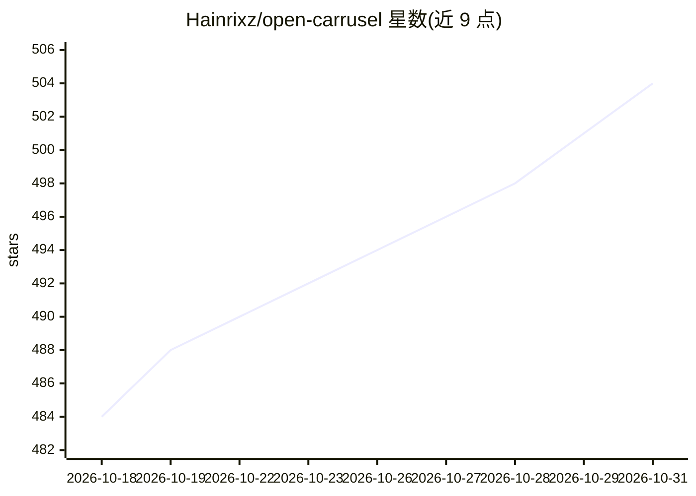

# Hainrixz/open-carrusel

⭐ 504 · TypeScript · MIT · 推送 2026-10-25 · [GitHub](https://github.com/Hainrixz/open-carrusel) · 个人维护

**通过与 Claude 对话生成 Instagram 轮播图并导出 PNG 的本地应用**

基于 Next.js 16/React 19 的本地优先 Web 应用，面向 Instagram 内容创作者：在浏览器编辑器中与 Claude 对话生成 HTML/CSS 幻灯片，经 Puppeteer 无头 Chromium 按三种 Instagram 精确像素尺寸截图并打包导出 PNG。AI 部分由 Claude CLI 子进程驱动（复用用户 Claude Code 认证，消息经 SSE 流回浏览器），无 Claude Code 时编辑器与导出仍可静态使用。数据存本地 JSON 文件，支持品牌配置、模板、参考图与逐页版本历史。可通过 Claude Code /start 一条命令启动，或 npm run setup 手动运行。

## 筛选速览

| 维度 | 判定 | 备注 |
|---|---|---|
| AI 角色 | `ai-native` | 本体是模型或模型工具 |
| 许可风险 | `permissive` | MIT |
| 部署形态 | `library` | 以包/库形式分发 |
| 模型依赖 | locked-api |  |
| 硬件要求 | — | 无带数字的原话,不猜 |
| 安装摩擦 | `low` | 无编译、无系统依赖或容器化 |
| 成熟度 | — | 结构信号不足 |

## 能力要点

- 对话生成 HTML/CSS 幻灯片，Puppeteer 按 1:1/4:5/9:16 精确像素导出 PNG
- AI 部分为 Claude CLI 子进程，复用用户已有 Claude Code 认证，SSE 流式返回
- 本地优先：数据存本地 JSON，无云、无账户、无数据库
- 品牌配置/模板/参考图注入 Claude 系统提示，逐页撤销与拖拽排序

## 适用场景

- 不想用 Canva/Figma 手工排版，直接对话生成 Instagram 轮播图
- 按品牌色与字体批量产出多页内容并一键导出标准尺寸图
- 本地保存所有轮播、模板与上传素材，不依赖云端服务

## 场景标签

`图像生成` · 领域:内容生成

## 证据(README 行号)

> L27: **Open Carrusel takes a different bet.** You chat with Claude — the same model many designers already trust — and i
> L92: The in-app agent is the **Claude CLI** spawned as a subprocess from `/api/chat` with `--allowedTools Bash WebFetch`

## 星数曲线

2026-10-18 484 → 2026-10-31 504（+20）

---
*卡片 v1 · prompt 1.4 · 生成 2026-10-21 · 置信度 high · 依据 README sha `8079e6c20bb7` · [字段定义](../../DATASET.md)*
