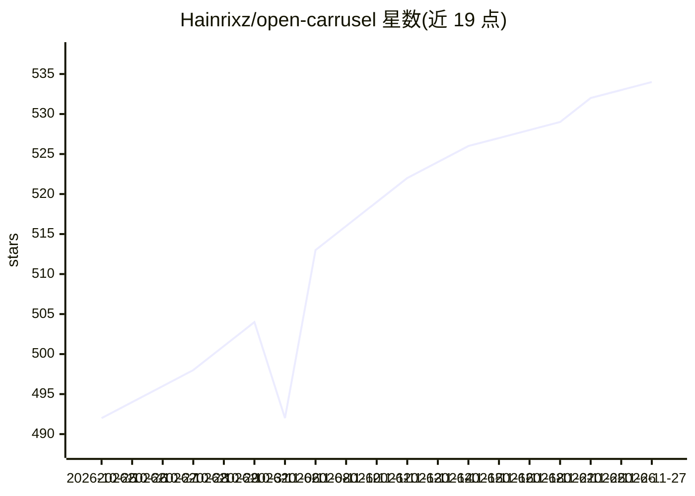

# Hainrixz/open-carrusel

⭐ 534 · TypeScript · MIT · 推送 2026-10-25 · [GitHub](https://github.com/Hainrixz/open-carrusel) · 个人维护

**与 Claude 对话生成 Instagram 轮播图并导出 PNG 的本地 Web 应用**

基于 Next.js 的本地单用户 Web 应用：通过聊天让 Claude CLI 子进程生成 HTML/CSS 幻灯片，经 Puppeteer 截图导出为三种 Instagram 尺寸的 PNG 并打包下载。编辑器提供聊天面板、实时预览、拖拽排序、品牌配置、模板与参考图功能，数据以 JSON 文件存于本地目录。无 AI 聊天时（未装 Claude Code）编辑器与静态幻灯片导出仍可用；导出依赖 Chromium 依赖库。

## 筛选速览

| 维度 | 判定 | 备注 |
|---|---|---|
| AI 角色 | `ai-native` | 本体是模型或模型工具 |
| 许可风险 | `permissive` | MIT |
| 部署形态 | `library` | 以包/库形式分发 |
| 模型依赖 | locked-api |  |
| 硬件要求 | — | 无带数字的原话,不猜 |
| 安装摩擦 | `low` | 无编译、无系统依赖或容器化 |
| 成熟度 | — | 结构信号不足 |

## 能力要点

- 对话生成幻灯片：Claude CLI 子进程写 HTML/CSS，SSE 流式返回
- 三种 Instagram 尺寸（1:1/4:5/9:16）Puppeteer 截图导出并打包
- 品牌配置（颜色/字体/logo/风格关键词）注入系统提示
- 本地 JSON 文件存储，无云端、无账号、无数据库

## 适用场景

- 为 Instagram 快速生成整组轮播图幻灯片
- 按品牌配色与字体保持社媒视觉一致
- 离线本地管理轮播项目与导出文件

## 场景标签

`聊天机器人` · 领域:对话与助手

## 证据(README 行号)

> L27: **Open Carrusel takes a different bet.** You chat with Claude — the same model many designers already trust — and i
> L92: The in-app agent is the **Claude CLI** spawned as a subprocess from `/api/chat` with `--allowedTools Bash WebFetch`
> L150: - **Local-first, single-user.** The whole app is a localhost web app talking to local files. No cloud, no auth, no

## 星数曲线

2026-10-25 492 → 2026-11-27 534（+42）

---
*卡片 v1 · prompt 1.4 · 生成 2026-11-25 · 置信度 high · 依据 README sha `8ba7ddb60fa7` · [字段定义](../../DATASET.md)*
