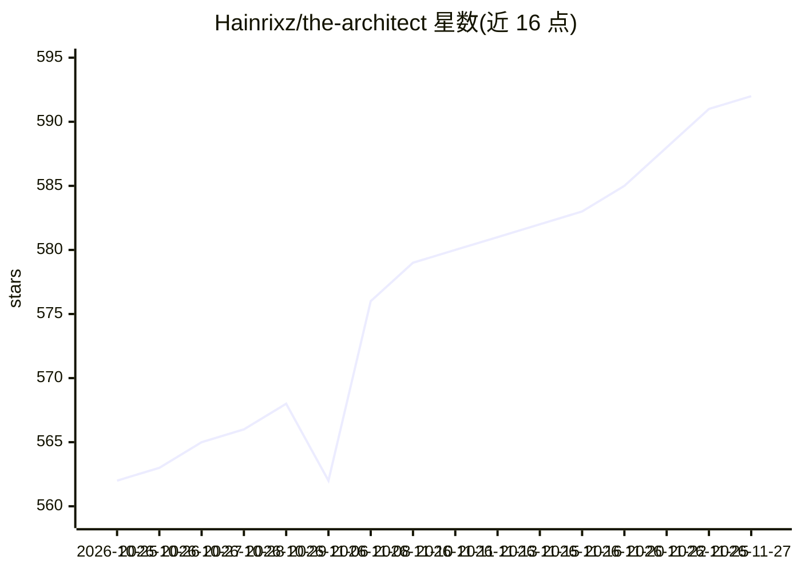

# Hainrixz/the-architect

⭐ 592 · MIT · 推送 2026-10-25 · [GitHub](https://github.com/Hainrixz/the-architect) · [官网](https://tododeia.com) · 个人维护

**Claude Code 插件：访谈需求并生成自包含软件架构蓝图**

以 Claude Code 插件形式运行的 meta-agent：通过 12-16 个问题（或 quick 模式 3 个问题）访谈用户，将项目分类到 14 种项目形态之一，选定技术栈后生成含 20 个固定章节的 Markdown 蓝图。蓝图带 EARS 形式的验收标准、每个构建步骤的 Verify 命令与 Checkpoint，供另一个零上下文的 Claude Code 实例据此构建。内置两道门禁（澄清标记清零与对抗性预验尸）及三个子代理（stack-researcher/blueprint-writer/blueprint-validator）做版本核实、撰写与审计。仅生成设计文档，不写应用代码；需要 Claude Code 与 Claude 订阅。

## 筛选速览

| 维度 | 判定 | 备注 |
|---|---|---|
| AI 角色 | `ai-ecosystem` | LLM/agent 周边工具 |
| 许可风险 | `permissive` | MIT |
| 部署形态 | `library` | 以包/库形式分发 |
| 模型依赖 | locked-api |  |
| 硬件要求 | — | 无带数字的原话,不猜 |
| 安装摩擦 | `low` | 无编译、无系统依赖或容器化 |
| 成熟度 | — | 结构信号不足 |

## 能力要点

- 14 种项目形态 + 3 轴知识分离（shape/runtime track/capability）
- 每个构建步骤含 Do/Done when/Verify/Checkpoint 四字段
- 两道门禁：[NEEDS CLARIFICATION] 清零与八角度对抗性预验尸
- 三个子代理：活体注册表版本核实、隔离撰写、对抗审计至 PASS

## 适用场景

- 在动手写代码前让 AI 访谈并产出完整架构蓝图
- 把蓝图交给自主构建代理后无需再回答问题
- 给已有项目（brownfield）做结构化的改造规划

## 场景标签

`编码 Agent` · 领域:编码与开发

## 证据(README 行号)

> L3:  A Claude Code meta-agent that designs complete software blueprints.
> L31: It does **not** write application code. It designs systems and produces blueprints — self-contained markdown files 
> L56: **Prerequisites:** Claude Code and a Claude subscription. Nothing else.

## 星数曲线

2026-10-25 562 → 2026-11-27 592（+30）

---
*卡片 v1 · prompt 1.4 · 生成 2026-11-25 · 置信度 mid · 依据 README sha `286528e74cab` · [字段定义](../../DATASET.md)*
