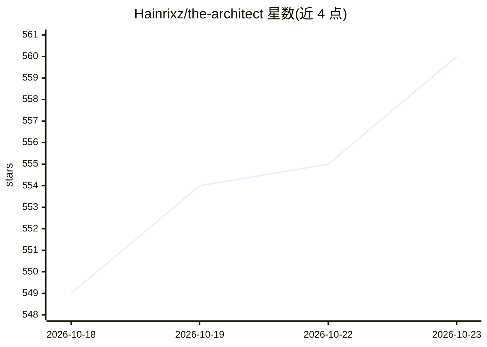

# Hainrixz/the-architect

⭐ 560 · MIT · 推送 2026-10-17 · [GitHub](https://github.com/Hainrixz/the-architect) · [官网](https://tododeia.com) · 个人维护

**Claude Code 插件：访谈式设计软件架构并生成可自主构建的蓝图**

The Architect 是一个 Claude Code 插件（meta-agent），不写应用代码，而是通过访谈收集需求，将项目分类为 14 种形态，经发现、深挖、架构、生成四阶段产出包含 20 个固定章节的自包含 Markdown 蓝图，供另一个零上下文的 Claude Code 实例逐步构建。每个构建步骤携带 Do/Done when/Verify/Checkpoint 四字段，验收标准采用 EARS 形式且须可由脚本判定。生成前强制通过两道关卡：无 [NEEDS CLARIFICATION] 标记与八角度对抗性预演。由三个子代理（stack-researcher/blueprint-writer/blueprint-validator）完成版本核验、撰写与审计。前置条件为 Claude Code 与 Claude 订阅。

## 筛选速览

| 维度 | 判定 | 备注 |
|---|---|---|
| AI 角色 | `ai-ecosystem` | LLM/agent 周边工具 |
| 许可风险 | `permissive` | MIT |
| 部署形态 | `library` | 以包/库形式分发 |
| 模型依赖 | locked-api |  |
| 硬件要求 | — | 无带数字的原话,不猜 |
| 安装摩擦 | `low` | 无编译、无系统依赖或容器化 |
| 成熟度 | — | 结构信号不足 |

## 能力要点

- 访谈后生成 20 章节自包含蓝图，供零上下文的构建实例使用
- 每步含 Do/Done when/Verify/Checkpoint，验收标准为 EARS 形式
- 生成前强制两道关卡：零未澄清标记与八角度对抗性预演
- stack-researcher 子代理对照线上注册表核验每个版本号

## 适用场景

- 把软件构想变成可交给自主构建代理执行的完整蓝图
- 新项目或遗留项目开工前先做架构设计与风险登记
- 需要可验证验收标准（脚本可判定）的构建计划

## 场景标签

`编码 Agent` · 领域:编码与开发

## 证据(README 行号)

> L3:  A Claude Code meta-agent that designs complete software blueprints.
> L31: It does **not** write application code. It designs systems and produces blueprints — self-contained markdown files 
> L40: /plugin marketplace add Hainrixz/the-architect

## 星数曲线

2026-10-18 549 → 2026-10-23 560（+11）

---
*卡片 v1 · prompt 1.4 · 生成 2026-10-21 · 置信度 mid · 依据 README sha `54f8dcc8836c` · [字段定义](../../DATASET.md)*
