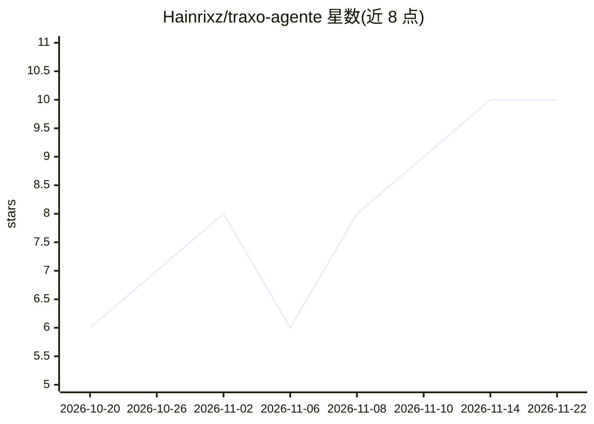

# Hainrixz/traxo-agente

⭐ 10 · TypeScript · MIT · 推送 2026-11-07 · [GitHub](https://github.com/Hainrixz/traxo-agente) · 个人维护

**从 Claude 运行电商业务的 agent：物流、追踪、营销与建店**

以 Claude Code 插件形式安装的开源 agent，在 Claude 内运行电商业务：订单到达时比价选快递、WhatsApp 确认高风险货到付款、生成面单并回写店铺、追踪包裹和处理投递异常；另有店铺审计、基于自有 UGC 素材的广告生成、消息收件箱（WhatsApp/Instagram/Messenger）与店铺构建器。通过向导安装器（/traxo:instalar）完成克隆、依赖、部署到 Railway 等步骤；敏感第三方密钥由用户手动填入 .env，不经过对话。提供 Web 面板、12 个 skill、4 个 agent 与含 41 个工具的 MCP server。首个完整支持市场为哥伦比亚，AI 功能需自备 Anthropic key 且有用量限额，失败时降级为规则回答。

## 筛选速览

| 维度 | 判定 | 备注 |
|---|---|---|
| AI 角色 | `ai-native` | 本体是模型或模型工具 |
| 许可风险 | `permissive` | MIT |
| 部署形态 | `library` | 以包/库形式分发 |
| 模型依赖 | locked-api |  |
| 硬件要求 | — | 无带数字的原话,不猜 |
| 安装摩擦 | `low` | 无编译、无系统依赖或容器化 |
| 成熟度 | — | 结构信号不足 |

## 能力要点

- 12 个 skill、4 个 agent、含 41 个工具的 MCP server，写/花/删操作需 confirm 才执行
- 广告基于用户上传的 UGC 视频与产品图生成，活动默认为草稿或暂停
- 密钥不经过对话与模型：向导生成内部密钥，第三方 key 用户自行填入 .env
- 可选 AI（ANTHROPIC_API_KEY）用于面板问答、客户回复理解与文案改写，带每分钟/每日用量上限

## 适用场景

- 让 agent 自动完成选快递、出面单、写回店铺与包裹追踪
- 在 Claude 中用自然语言查询店铺销售、广告效果与订单状态
- 从自有 UGC 素材库搭建营销活动
- 从商品目录生成 Shopify 主题店铺

## 场景标签

`AI 写作` `工作流自动化` `代码生成` · 领域:效率与自动化

## 证据(README 行号)

> L20: Traxo is an **open-source agent that runs your e-commerce from inside Claude**. When an order comes in it quotes ca
> L125: Messages show up in **Messages** and the agent handles them. Traxo is also an MCP server, so from Claude you can u
> L129: With the plugin installed you get **12 skills** (`instalar`, `constructor`, `start`, `conectar`, `pedidos`, `envio

## 星数曲线

2026-10-20 6 → 2026-11-22 10（+4）

---
*卡片 v1 · prompt 1.4 · 生成 2026-11-20 · 置信度 high · 依据 README sha `2535e1a1f51f` · [字段定义](../../DATASET.md)*
