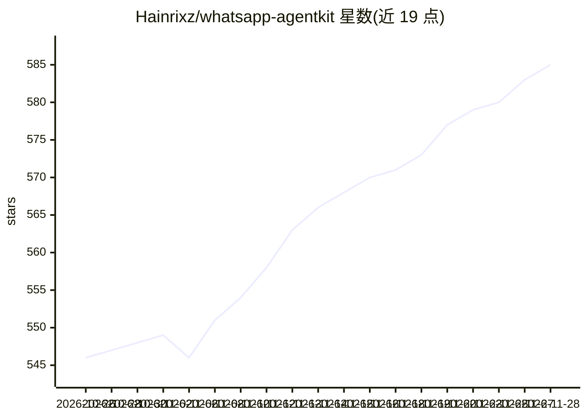

# Hainrixz/whatsapp-agentkit

⭐ 585 · Python · MIT · 推送 2026-11-12 · [GitHub](https://github.com/Hainrixz/whatsapp-agentkit) · [官网](https://hainrixz.github.io/whatsapp-agentkit/) · 个人维护

**不写代码也能生成 WhatsApp 客服 Agent 的指令系统**

一套供 Claude Code 读取的指令系统（CLAUDE.md + start.sh + 审计脚本）：通过 /build-agent 命令分五阶段运行——环境检查、向用户提 10 个业务问题、生成完整项目代码（FastAPI 服务器、WhatsApp 连接、SQLite/PostgreSQL 历史与去重、HMAC-SHA256 签名校验）、终端内测试、指导部署到 Railway。WhatsApp 接入支持 Zernio 或 Meta Cloud API，采用适配器模式可迁移。面向不写代码的小微商家，README 为西语，MIT 许可。

## 筛选速览

| 维度 | 判定 | 备注 |
|---|---|---|
| AI 角色 | `ai-ecosystem` | LLM/agent 周边工具 |
| 许可风险 | `permissive` | MIT |
| 部署形态 | `library` | 以包/库形式分发 |
| 模型依赖 | locked-api |  |
| 硬件要求 | — | 无带数字的原话,不猜 |
| 安装摩擦 | `low` | 无编译、无系统依赖或容器化 |
| 成熟度 | — | 结构信号不足 |

## 能力要点

- Claude Code 五阶段流程：采访→生成→测试→部署，用户只回答问题
- WhatsApp 双通道接入：Zernio（推荐）或 Meta Cloud API，适配器模式可互相迁移
- webhook 机制：先确认后处理、按事件 id 去重、HMAC-SHA256 签名校验
- 每个客户独立会话历史，不知情时明示并转人工

## 适用场景

- 给餐馆、诊所、网店做一个接单答疑的 WhatsApp 客服
- 不用写代码就能上线一个回答常见问题的机器人
- 用自然语言让 Claude Code 调整 Agent 的语气或功能

## 场景标签

`聊天机器人` · 领域:对话与助手

## 证据(README 行号)

> L19: No es una plantilla que copias y adaptas. Es un sistema de instrucciones que Claude Code
> L20: lee para entrevistarte sobre tu negocio y después escribir, probar y desplegar el agente
> L53: `start.sh` solo verifica tu entorno. El sistema real arranca con `/build-agent`, que hace

## 星数曲线

2026-10-26 546 → 2026-11-28 585（+39）

---
*卡片 v1 · prompt 1.4 · 生成 2026-11-25 · 置信度 high · 依据 README sha `798b2524ff15` · [字段定义](../../DATASET.md)*
