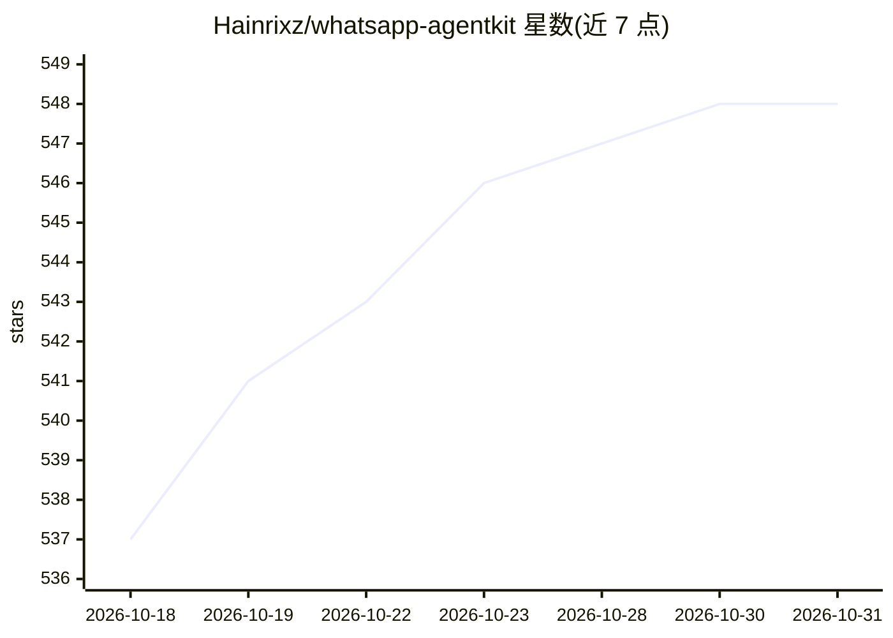

# Hainrixz/whatsapp-agentkit

⭐ 548 · Python · MIT · 推送 2026-10-25 · [GitHub](https://github.com/Hainrixz/whatsapp-agentkit) · [官网](https://hainrixz.github.io/whatsapp-agentkit/) · 个人维护

**用 Claude Code 访谈式生成 WhatsApp AI 客服 agent 的工具包**

面向拉美西语用户和无编程基础者的开源项目（MIT）：Claude Code 读取 CLAUDE.md 后执行五阶段流程——检查 Python 环境、向用户提出十个业务问题、生成完整的 FastAPI 服务器与 agent 代码、终端测试、部署到 Railway。WhatsApp 接入可选 Zernio 或 Meta Cloud API，采用适配器模式切换。agent 使用 Claude API 生成回复，SQLite/PostgreSQL 存储对话历史与事件去重，webhook 做 HMAC-SHA256 签名校验。限制：不能自主执行日历/库存/收款等动作，需后续扩展。

## 筛选速览

| 维度 | 判定 | 备注 |
|---|---|---|
| AI 角色 | `ai-native` | 本体是模型或模型工具 |
| 许可风险 | `permissive` | MIT |
| 部署形态 | `library` | 以包/库形式分发 |
| 模型依赖 | locked-api |  |
| 硬件要求 | — | 无带数字的原话,不猜 |
| 安装摩擦 | `low` | 无编译、无系统依赖或容器化 |
| 成熟度 | — | 结构信号不足 |

## 能力要点

- Claude Code 通过五阶段访谈自动编写并部署完整 agent（服务器/WhatsApp 连接/客户记忆/人设 prompt）
- Zernio 与 Meta Cloud API 双通道，适配器模式切换
- webhook 先确认后处理、事件 ID 去重、HMAC-SHA256 签名校验
- 每客户独立对话历史，未知信息不编造并转人工

## 适用场景

- 让小商家在 30 分钟内拥有 WhatsApp 客服 agent
- 餐厅/诊所/电商通过 WhatsApp 回答菜单、预约、接单
- 无编程经验者用自然语言让 Claude Code 调整 agent 行为

## 场景标签

`编码 Agent` `聊天机器人` · 领域:编码与开发

## 证据(README 行号)

> L16: **WhatsApp AgentKit convierte una conversación de 20 minutos en un agente de WhatsApp
> L256: |IA|Claude (`claude-sonnet-5` por default)|Genera las respuestas|
> L292: Todo corre en tu infraestructura: tu servidor, tu base de datos, tus API keys. AgentKit

## 星数曲线

2026-10-18 537 → 2026-10-31 548（+11）

---
*卡片 v1 · prompt 1.4 · 生成 2026-10-21 · 置信度 mid · 依据 README sha `edd09d895ce7` · [字段定义](../../DATASET.md)*
