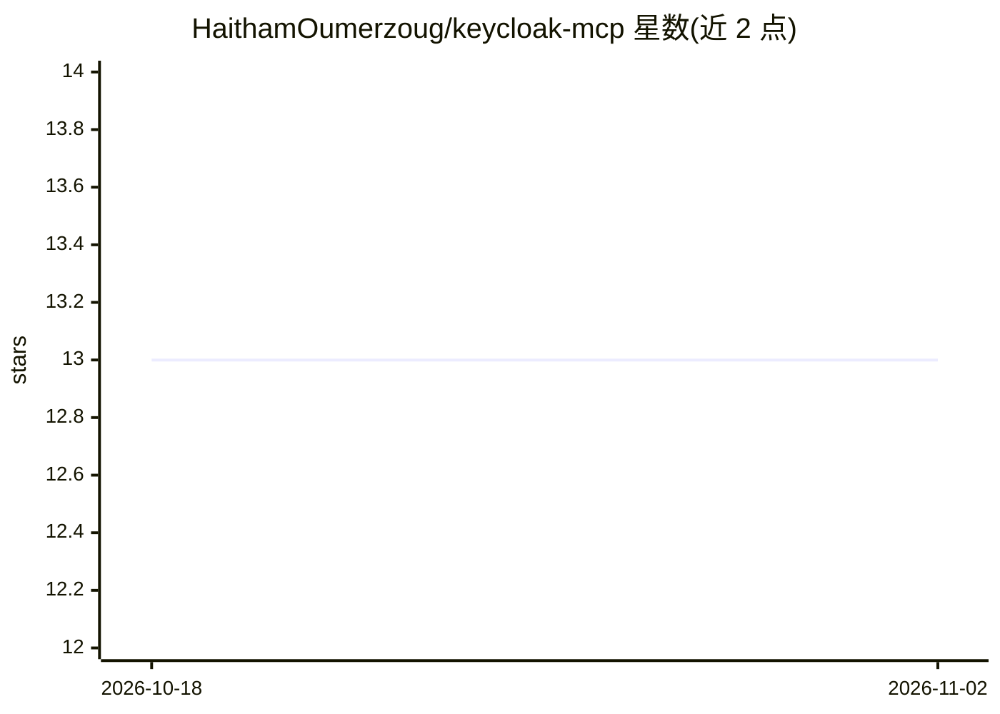

# HaithamOumerzoug/keycloak-mcp

⭐ 13 · TypeScript · MIT · 推送 2025-12-01 · [GitHub](https://github.com/HaithamOumerzoug/keycloak-mcp) · [官网](https://www.npmjs.com/package/keycloak-mcp) · 个人维护

**让 AI agent 通过 MCP 管理 Keycloak 用户与 realm 的服务器**

基于 Model Context Protocol 的 Keycloak 管理服务器：通过官方 Keycloak Admin Client 调用 Keycloak API，向 MCP 客户端（如 Claude Desktop、Cursor、Cline）暴露 9 个工具，覆盖创建/删除用户、列出 realm/用户/客户端/组/客户端角色、分配客户端角色、添加用户到组。以 NPM 包发布，支持 npx 直接运行或全局安装，通过命令行参数或环境变量传入 Keycloak 地址与管理员凭据；前提是需有 Node.js 与运行中的 Keycloak 实例。

## 筛选速览

| 维度 | 判定 | 备注 |
|---|---|---|
| AI 角色 | `ai-ecosystem` | LLM/agent 周边工具 |
| 许可风险 | `permissive` | MIT |
| 部署形态 | `library` | 以包/库形式分发 |
| 模型依赖 | — | README 未给出锁定关系 |
| 硬件要求 | — | 无带数字的原话,不猜 |
| 安装摩擦 | `low` | 无编译、无系统依赖或容器化 |
| 成熟度 | — | 结构信号不足 |

## 能力要点

- 9 个工具覆盖 Keycloak 用户、realm、客户端、组与角色的管理操作
- 使用官方 Keycloak Admin Client 对接 Keycloak API
- 通过 npx/npm 安装，支持 Smithery 自动化安装到 Claude Desktop
- 命令行参数与环境变量两种配置方式，参数优先级更高

## 适用场景

- 在 Claude Desktop 或 Cursor 中通过对话管理 Keycloak 用户与权限
- 为接入 Keycloak 的 AI agent 提供标准化身份管理接口
- 以自然语言完成创建用户、分配角色等日常管理任务

## 场景标签

 · 领域:身份与访问管理/AI 基础设施

## 证据(README 行号)

> L9: A Model Context Protocol (MCP) server implementation for Keycloak, providing a standardized interface for managing K
> L17: This project implements an MCP server that integrates with Keycloak, allowing you to manage Keycloak users and real
> L196: - `@modelcontextprotocol/sdk` - MCP SDK for standardized protocol implementation

## 星数曲线

2026-10-18 13 → 2026-11-02 13（+0）

---
*卡片 v1 · prompt 1.4 · 生成 2026-10-31 · 置信度 high · 依据 README sha `878b5c41324b` · [字段定义](../../DATASET.md)*
