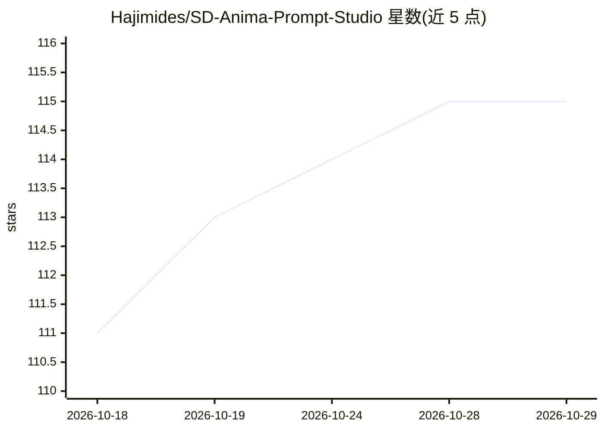

# Hajimides/SD-Anima-Prompt-Studio

⭐ 115 · HTML · NOASSERTION · 推送 2026-07-16 · [GitHub](https://github.com/Hajimides/SD-Anima-Prompt-Studio) · [官网](https://hajimides.github.io/SD-Anima-Prompt-Studio/) · 个人维护 · 中文 README

**Stable Diffusion / Anima 提示词构建器：浏览器内直接使用的纯前端工具**

面向 AI 绘图用户的提示词组合网页工具：提供 12+ 分类提示词库（画质、风格、角色、服装、动作等），支持 SD 与 Anima 双模式切换（Anima 模式自动添加前缀），内置动作 Tag 与自然语言描述的互斥检测、实时预览与字符计数、一键复制与随机组合，以及带 18+ 确认弹窗的 NSFW 模式框架（完整 NSFW 词库尚未加入）。纯客户端运行，下载 index.html 用浏览器打开即可，无需安装；支持简繁中文与英文界面，附 GitHub Pages 部署步骤和在线 Demo。

## 筛选速览

| 维度 | 判定 | 备注 |
|---|---|---|
| AI 角色 | `ai-ecosystem` | LLM/agent 周边工具 |
| 许可风险 | `permissive` | NOASSERTION |
| 部署形态 | `None` |  |
| 模型依赖 | — | README 未给出锁定关系 |
| 硬件要求 | — | 无带数字的原话,不猜 |
| 安装摩擦 | `low` | 无编译、无系统依赖或容器化 |
| 成熟度 | — | 结构信号不足 |

## 能力要点

- 12+ 分类提示词库，含角色卡片与实例作品预览
- 动作 Tag 与自然语言描述的智能互斥检测
- SD / Anima 双模式，Anima 模式自动添加前缀
- 纯客户端运行，浏览器打开 index.html 即可用，支持中英文界面

## 适用场景

- 为 Stable Diffusion 或 Anima 挑选并组合提示词
- 避免动作类 Tag 与自然语言描述冲突
- 通过在线 Demo 或 GitHub Pages 快速使用与部署

## 场景标签

`提示工程` · 领域:Agent 开发

## 证据(README 行号)

> L3: > A beautiful glassmorphism web UI for building Stable Diffusion & Anima prompts
> L17: - **Real-time Prompt Builder** — Live preview, character count, one-click copy, and shuffle

## 星数曲线

2026-10-18 111 → 2026-10-29 115（+4）

---
*卡片 v1 · prompt 1.4 · 生成 2026-10-23 · 置信度 high · 依据 README sha `219e9009ce72` · [字段定义](../../DATASET.md)*
