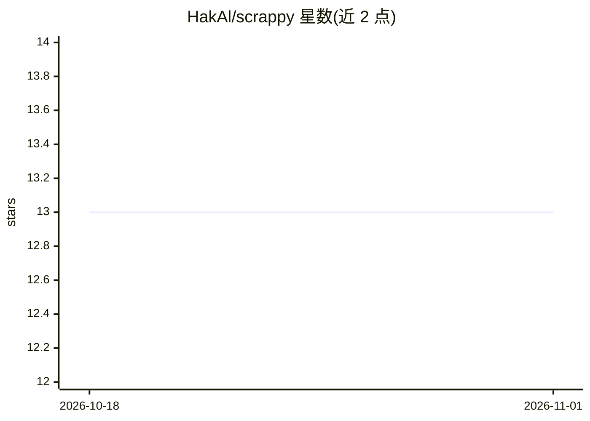

# HakAl/scrappy

⭐ 13 · Python · MIT · 推送 2026-10-13 · [GitHub](https://github.com/HakAl/scrappy) · [官网](https://pypi.org/project/scrappy-ai/) · 个人维护

**免费 LLM 编排的代码库感知 AI 编程助手（CLI）**

Python CLI 编程助手，将 Cerebras、Groq、Gemini 三家免费额度 LLM 提供商编排起来，配合本地 BGE-small 嵌入（33MB）与 LanceDB 索引实现代码库语义检索，回答针对用户代码的提问。提供上下文感知聊天、带逐步人工确认的 /agent 多步任务模式、diff 预览、基于 Git 的检查点回滚、供应商限流自动故障切换、会话持久化。面向学生、付费受限地区开发者等用户，需 Python 3.11+、Git 与至少一个免费 API key；聊天需联网，索引与搜索在首次模型下载后可离线运行。

## 筛选速览

| 维度 | 判定 | 备注 |
|---|---|---|
| AI 角色 | `ai-ecosystem` | LLM/agent 周边工具 |
| 许可风险 | `permissive` | MIT |
| 部署形态 | `library` | 以包/库形式分发 |
| 模型依赖 | locked-api |  |
| 硬件要求 | — | 无带数字的原话,不猜 |
| 安装摩擦 | `low` | 无编译、无系统依赖或容器化 |
| 成熟度 | — | 结构信号不足 |

## 能力要点

- 本地 BGE-small 嵌入 + LanceDB 代码库索引，语义检索离线运行
- /agent 多步任务模式，每步 diff 预览并需人工批准
- 多供应商限流自动故障切换（宣称每日 23,000+ 免费请求）
- Git 检查点与回滚、会话自动保存

## 适用场景

- 不付订阅费，用免费额度 AI 助手理解并修改我的代码库
- 让 agent 逐步执行重构、写测试等多步编码任务并逐 diff 审核
- 在支付受限地区获得可用的 AI 编程助手

## 场景标签

`AI 助手` `编码 Agent` · 领域:编码与开发

## 证据(README 行号)

> L9: Scrappy orchestrates free-tier LLM providers (Cerebras, Groq, Gemini) into a context-aware coding assistant that und
> L117: 1. **Indexing**: BGE-small embeddings (33MB, runs locally) index your codebase into LanceDB
> L119: 3. **Orchestration**: Scrappy routes requests across providers, handling rate limits automatically

## 星数曲线

2026-10-18 13 → 2026-11-01 13（+0）

---
*卡片 v1 · prompt 1.4 · 生成 2026-10-31 · 置信度 high · 依据 README sha `3389d954e676` · [字段定义](../../DATASET.md)*
