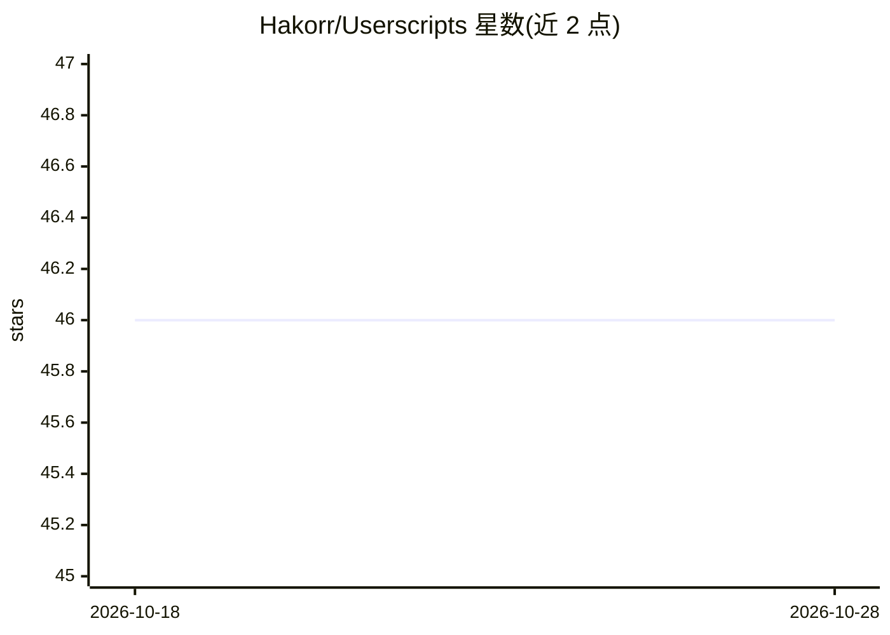

# Hakorr/Userscripts

⭐ 46 · JavaScript · 推送 2026-04-14 · [GitHub](https://github.com/Hakorr/Userscripts) · [官网](https://github.com/Hakorr) · 个人维护

**个人浏览器用户脚本合集，含多站点小工具**

个人维护的 userscript（用户脚本）集合仓库，README 仅说明脚本为个人即兴制作（bodge 风格）、非专业水准，并附 Monero 捐赠指引。仓库主题标签覆盖 GitHub、Discord、Reddit、Telegram、DuckDuckGo、Pixlr、Aternos、YLE 等站点的脚本。README 未列出具体脚本清单、安装方法或功能细节，需浏览仓库目录获取。

## 筛选速览

| 维度 | 判定 | 备注 |
|---|---|---|
| AI 角色 | `ai-enhanced` | 去掉 AI 部分产品仍成立 |
| 许可风险 | `none` | — |
| 部署形态 | `None` |  |
| 模型依赖 | — | README 未给出锁定关系 |
| 硬件要求 | — | 无带数字的原话,不猜 |
| 安装摩擦 | `low` | 无编译、无系统依赖或容器化 |
| 成熟度 | — | 结构信号不足 |

## 能力要点

- 覆盖 GitHub、Discord、Reddit、Telegram 等多站点的用户脚本
- 作者自述为 bodge 风格的个人脚本

## 适用场景

- 为常用网站寻找小功能增强脚本
- 参考他人 userscript 写法

## 场景标签

 · 领域:浏览器脚本/工具

## 证据(README 行号)

> L1: # My userscripts

## 星数曲线

2026-10-18 46 → 2026-10-28 46（+0）

---
*卡片 v1 · prompt 1.4 · 生成 2026-10-25 · 置信度 low · 依据 README sha `a28b675f003e` · [字段定义](../../DATASET.md)*
