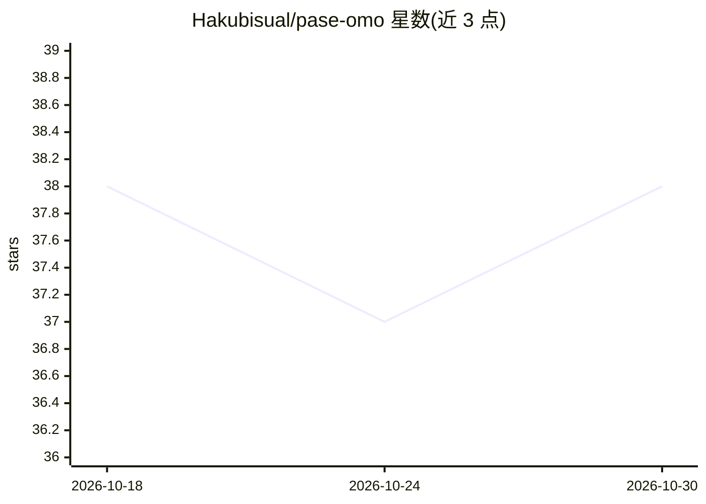

# Hakubisual/pase-omo

⭐ 38 · TypeScript · MIT · 推送 2026-10-03 · [GitHub](https://github.com/Hakubisual/pase-omo) · [官网](https://github.com/code-yeongyu/omo) · 个人维护

**在 Paseo 中接入 OmO 5 agent 并可视化其 DAG 工作流的插件**

Paseo 桌面/移动端的插件：将 OmO 5 注册为 Paseo 的 agent provider，出现在模型选择器中，支持流式输出、工具调用与 task() 子会话；OmO 的提问通过 Paseo 原生问题卡呈现，回答直接回传。workflow 运行以看板展示：每波一列、每节点一卡，边上有运行动画，卡片显示状态、耗时、tokens/秒与进度；另提供审批面板、会话文件夹树与一键更新 OmO。要求 Paseo 0.8.0+ 与已安装的 OmO 5，通过 paseo plugin add 安装；插件无沙箱，以 daemon 用户权限运行。

## 筛选速览

| 维度 | 判定 | 备注 |
|---|---|---|
| AI 角色 | `ai-ecosystem` | LLM/agent 周边工具 |
| 许可风险 | `permissive` | MIT |
| 部署形态 | `None` |  |
| 模型依赖 | — | README 未给出锁定关系 |
| 硬件要求 | — | 无带数字的原话,不猜 |
| 安装摩擦 | `low` | 无编译、无系统依赖或容器化 |
| 成熟度 | — | 结构信号不足 |

## 能力要点

- OmO 注册为 Paseo 模型选择器中的 provider，支持流式与工具调用
- workflow 运行以 DAG 看板展示（波次列、节点卡、运行动画、活动日志）
- OmO 提问走 Paseo 原生问题卡，每轮收敛为单张 todo 卡
- 提供韩语分支（ko ref）与移动端适配的看板视图

## 适用场景

- 在 Paseo 中直接运行并观察 OmO 的多节点工作流
- 通过原生问题卡回答 agent 的审批与选择
- 在手机上查看 DAG 运行进度与子任务

## 场景标签

 · 领域:AI agent 工具/桌面插件

## 证据(README 行号)

> L16: - **OmO 5 is the engine.** Sessions open on OmO's own default model, the model
> L99: |**OmO provider**|OmO in Paseo's model picker, with streaming, tool calls and child sessions in Paseo's chat|
> L173: |`index.server.ts`|Daemon side: the agent provider, DAG and approval RPCs, the timeline publisher|

## 星数曲线

2026-10-18 38 → 2026-10-30 38（+0）

---
*卡片 v1 · prompt 1.4 · 生成 2026-10-25 · 置信度 high · 依据 README sha `524d26764ea1` · [字段定义](../../DATASET.md)*
