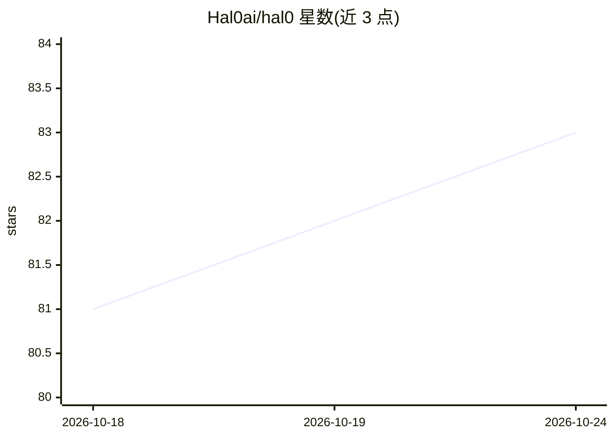

# Hal0ai/hal0

⭐ 83 · Apache-2.0 · 推送 2026-10-23 · [GitHub](https://github.com/Hal0ai/hal0) · [官网](https://hal0.dev) · 组织维护

**面向 AMD Strix Halo 的自托管家庭 AI 推理平台**

在 Linux 主机（首选 Ryzen AI Max+ 395 + 128GB 统一内存）上部署的私有 OpenAI 兼容推理设备：聊天、补全、嵌入、重排、转录、语音与图像生成统一暴露在 :8080/v1。每个推理负载作为独立 podman 容器运行于 hal0-slot systemd 单元下，hal0-api 作为唯一控制平面管理槽位状态机并分发请求；硬件探测自动选择 ROCm/Vulkan/CUDA/CPU/NPU 后端。仅支持 Linux + systemd + podman（macOS/Windows 不支持），安装为 curl 一行脚本，另含 Open WebUI、Hermes agent、ComfyUI、Hindsight 记忆引擎等伴随服务。

## 筛选速览

| 维度 | 判定 | 备注 |
|---|---|---|
| AI 角色 | `ai-ecosystem` | LLM/agent 周边工具 |
| 许可风险 | `permissive` | Apache-2.0 |
| 部署形态 | `library` | 以包/库形式分发 |
| 模型依赖 | local-ok | 支持本地模型 |
| 硬件要求 | — | 无带数字的原话,不猜 |
| 安装摩擦 | `medium` | 含编译或系统依赖之一 |
| 成熟度 | — | 结构信号不足 |

## 能力要点

- 每能力一槽位：独立 podman 容器 + 独立硬件后端 + 槽位状态机
- 单一 :8080/v1 OpenAI 兼容面覆盖聊天/嵌入/重排/转录/语音/图像生成
- 硬件探测自动选择 ROCm/Vulkan/CUDA/CPU/NPU 后端
- Cosign 签名发布与 hal0 update 一键回滚

## 适用场景

- 把一台 Ryzen AI Max 主机变成家庭私有推理服务
- 用任意 OpenAI 兼容客户端访问本地多模态能力
- 在 Proxmox LXC 中部署自托管 AI 推理栈

## 场景标签

`推理引擎` `模型网关` `图像生成` `多模态` · 领域:Agent 开发

## 证据(README 行号)

> L16: `hal0-slot@<name>.service` unit. `hal0-api` on `:8080` is the sole control
> L59: |**What it is**|One control plane, `hal0-api` on `:8080`, turning a Linux box into an OpenAI-compatible inference a

## 星数曲线

2026-10-18 81 → 2026-10-24 83（+2）

---
*卡片 v1 · prompt 1.4 · 生成 2026-10-24 · 置信度 mid · 依据 README sha `885339b1ee88` · [字段定义](../../DATASET.md)*
