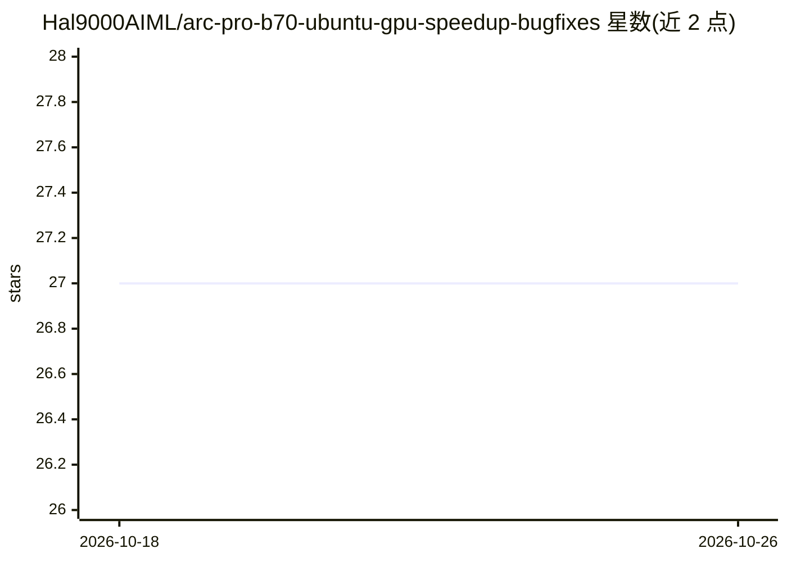

# Hal9000AIML/arc-pro-b70-ubuntu-gpu-speedup-bugfixes

⭐ 27 · Python · Unlicense · 推送 2026-05-10 · [GitHub](https://github.com/Hal9000AIML/arc-pro-b70-ubuntu-gpu-speedup-bugfixes) · 个人维护

**Intel Arc Pro B70 上 llama.cpp 本地 LLM 推理的调优补丁与配置套件**

面向 Ubuntu Server + Intel Arc Pro B70 (BMG G31/Xe2) 显卡的 llama.cpp 调优套件：包含 11 个 cherry-pick 补丁（修复 MoE slot-init SEGV、Q8_0 reorder 崩溃、缺失的 BF16 GET_ROWS、Xe2 Vulkan warptile、K-quant DMMV 等）、Mesa 26+ 安装脚本、按模型分类的启动脚本与 systemd 单元，以及 SYCL/Vulkan 后端选择规则和基准数据。作者在 4× B70 机器上以 5 个并发 llama-server 层级运行验证。SYCL 后端需自行安装 Intel oneAPI Base Toolkit，补丁经构建脚本编译应用。

## 筛选速览

| 维度 | 判定 | 备注 |
|---|---|---|
| AI 角色 | `ai-ecosystem` | LLM/agent 周边工具 |
| 许可风险 | `permissive` | Unlicense |
| 部署形态 | `None` |  |
| 模型依赖 | local-ok | 支持本地模型 |
| 硬件要求 | — | 无带数字的原话,不猜 |
| 安装摩擦 | `high` | 编译与系统依赖俱全 |
| 成熟度 | — | 结构信号不足 |

## 能力要点

- 11 个针对 Xe2/B70 的 llama.cpp cherry-pick 补丁（SYCL 8 个、Vulkan 2 个、实验性 1 个）
- 按模型提供启动脚本、systemd 单元与 SYCL/Vulkan 后端选择规则
- 记录运行时环境变量 workaround（如 MoE 必需 GGML_SYCL_DISABLE_OPT=1）
- 提供基准数字与 b70-plan.py 后端自动选择器

## 适用场景

- 让 Arc Pro B70 显卡在本机跑 llama.cpp 推理获得可用吞吐
- 规避 MoE 模型在 SYCL 后端的 slot-init 挂起/崩溃
- 在单机多卡上并发运行多个模型的分层推理服务

## 场景标签

`推理引擎` · 领域:训练与推理

## 证据(README 行号)

> L5: Out-of-the-box `llama.cpp` on Arc Pro B70 (BMG G31, Xe2, 32GB) leaves 2–7× on the floor depending on the model and b
> L8: - Patched llama.cpp binaries (SYCL and Vulkan) with the 11 commits that matter on Xe2
> L66: Every patch in `patches/` lands on top of llama.cpp master `073bb2c20` (2026-04). Each one is listed below with wha

## 星数曲线

2026-10-18 27 → 2026-10-26 27（+0）

---
*卡片 v1 · prompt 1.4 · 生成 2026-10-26 · 置信度 high · 依据 README sha `0b3c2e0804b5` · [字段定义](../../DATASET.md)*
