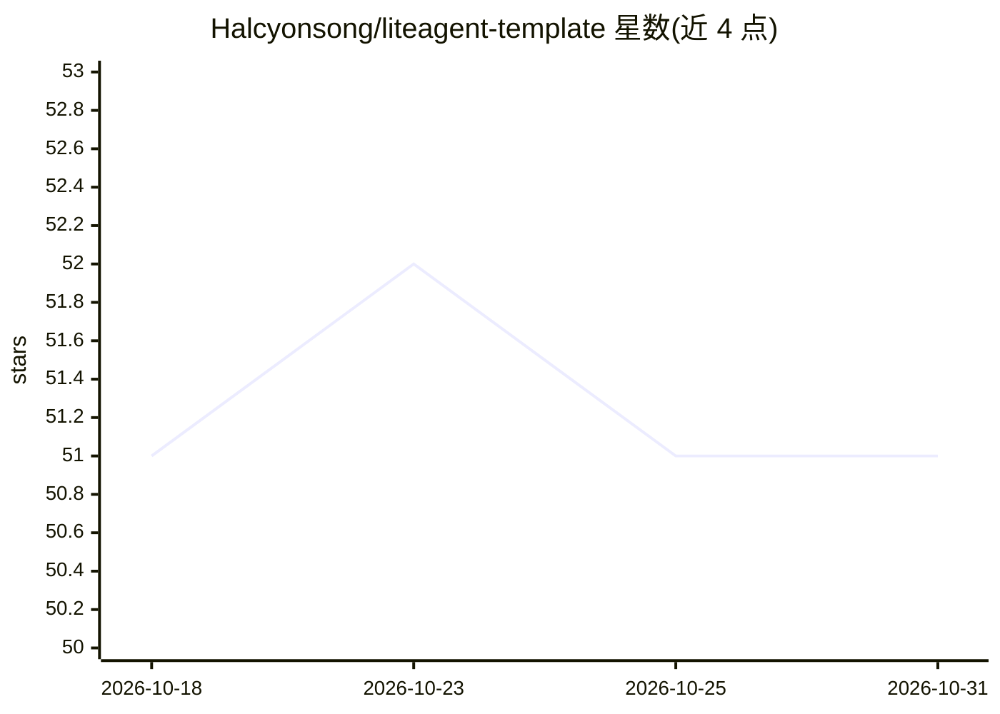

# Halcyonsong/liteagent-template

⭐ 51 · Java · NOASSERTION · 推送 2026-08-20 · [GitHub](https://github.com/Halcyonsong/liteagent-template) · 个人维护 · 中文 README

**Java 轻量级 LLM/Agent 调用框架：可插拔步骤编排与工具调用**

基于 Java 17 的 Maven 多模块框架，将 Agent 编排拆为注册到 Map 的独立可替换步骤，每步返回值决定下一步，编排上下文全程可读写，并可通过 StepHook 观察过程。支持 OpenAI-compatible 协议的同步/流式调用、注解式工具注册与自动执行、请求响应增强器（Advisor）、会话记忆窗口加载与写回。面向需要在工具调用回环中介入自定义逻辑的 Java 开发者。示例模块依赖 Spring Boot 配置外部服务地址与 API Key，文档以可运行示例形式提供。

## 筛选速览

| 维度 | 判定 | 备注 |
|---|---|---|
| AI 角色 | `ai-ecosystem` | LLM/agent 周边工具 |
| 许可风险 | `none` | NOASSERTION |
| 部署形态 | `None` |  |
| 模型依赖 | — | README 未给出锁定关系 |
| 硬件要求 | — | 无带数字的原话,不猜 |
| 安装摩擦 | `high` | 编译与系统依赖俱全 |
| 成熟度 | — | 结构信号不足 |

## 能力要点

- 步骤化 Agent 编排：步骤可替换可插拔，返回值决定下一步
- OpenAI-compatible 协议的同步 Chat 与流式 Stream 调用
- 注解式工具注册、工具描述生成与自动执行回环
- 会话记忆窗口：编排开始加载历史、结束折叠写回

## 适用场景

- 在 Java 项目中接入 OpenAI-compatible 服务并做工具调用
- 需要监控与介入每轮工具调用流程的 Agent 编排
- 为对话应用维护跨请求的会话记忆

## 场景标签

`Agent 框架` · 领域:Agent 开发

## 证据(README 行号)

> L5: `liteagent-template` 是一个基于 Java 17 的轻量级 LLM / Agent 调用框架。核心思路是把 Agent 编排拆成独立步骤，注册到 Map 里，每步返回值决定下一步——所有步骤可替换、可插拔，编排上
> L53: |`liteagent-agent`|提供与供应商无关的同步和流式 Agent 编排抽象，包括执行器、步骤、上下文与 Hook。|

## 星数曲线

2026-10-18 51 → 2026-10-31 51（+0）

---
*卡片 v1 · prompt 1.4 · 生成 2026-10-24 · 置信度 high · 依据 README sha `d30d054e2324` · [字段定义](../../DATASET.md)*
